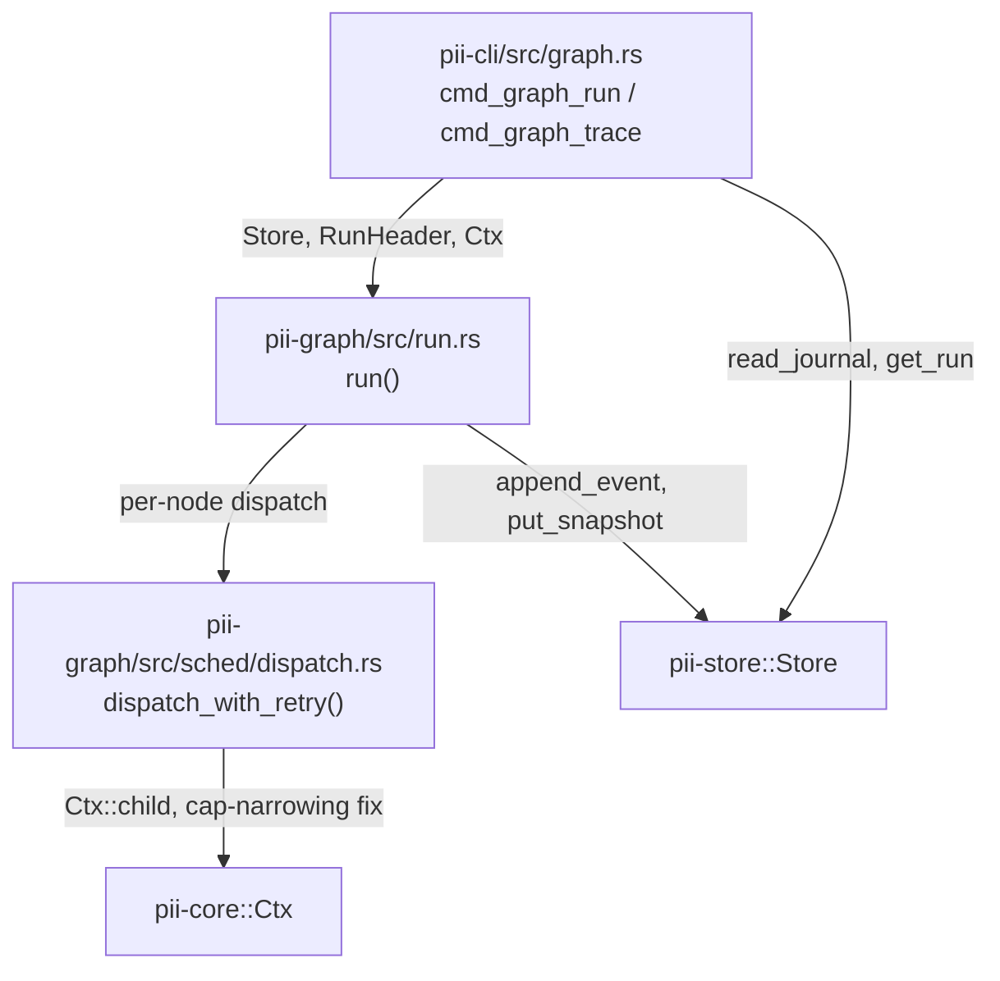

# pi-improved — spec-05: run engine part 1 — journal, cap-narrowing fix, CLI run/trace

- **Project**: `/projects/pi-improved`
- **Priority**: `pii graph run/resume/trace` currently print "not yet wired" and exit 2 — HANDOFF.md's last remaining Phase-1 item. This part lands the journal/store wiring and the cap-narrowing bug fix that everything else (concurrency in spec-06, resume in spec-07) builds on.
- **Status**: SPECIFIED — not yet dispatched
- **Source**: user task "wire store-backed pii graph run/resume/trace" (2026-09-02), split after discovering `run.rs` has no journaling, no concurrency, no retry, and a cap-narrowing bug — far more remains than the CLI layer.
- **Depends-On**: none. **Blocks**: spec-06 (concurrent dispatch), spec-07 (crash-resume).

---

## Verified Premises

- `crates/pii-graph/src/run.rs:41` — `pub fn run(spec, reg, ctx, _run: &RunId, input) -> Result<Terminal, PiiError>` exists but takes no `Store`, journals nothing, dispatches its batch with a plain sequential `for` loop (no threads), and `_run` is dead (prefixed, unused — `Principal::GraphNode` hardcodes `RunId::from("run")` at line 123).
- `crates/pii-graph/src/run.rs:119-128` (`dispatch_one`) — every node's child `Ctx` is built with `let node_caps = CapSet::empty();`. Since `Ctx::child` **intersects** (`crates/pii-core/src/ctx.rs:129`), this denies every capability to every node regardless of what the graph or node declares. This is the bug the task names; the fix is below (R2).
- `crates/pii-graph/src/validate.rs:77-93` (V2 check) — the capability a node actually needs at runtime is **not** `n.caps` alone. It is `required = reg.factory(&n.kind)?.required_caps() | CapKind::from_bits_truncate(n.caps)`, checked against `CapKind::from_bits_truncate(spec.caps)`. Confirmed against `crates/pii-graph/src/toml_load.rs:110-125`: node-level `caps` defaults to **empty** when omitted from TOML, and `examples/emit-path.toml` / `examples/crash-resume.toml` declare `caps = ["fs_write"]` at the **graph** level only — their `emit` nodes carry no node-level `caps` at all. The only reason `emit` gets `FS_WRITE` is `EmitFactory::required_caps()`. A fix that uses `n.caps` alone (as a literal reading of the task's bug note would) makes `emit-path.toml` and `crash-resume.toml` fail to write **at all**, even inside the allow-scope. R2 below uses the verified formula, matching V2 exactly.
- `crates/pii-core/src/fscap.rs:54-131` — symlink-escape denial is **already fully implemented** inside `FsCap`: `canonical_for` resolves via `dunce::canonicalize`, falling back to canonicalizing the parent when the target doesn't exist yet (the write-new-file case), and the scope check (`caps.fs_write.permits(&canonical)`) runs **after** canonicalization. `EmitNode::run` (`crates/pii-graph/src/nodes.rs:171-194`) does no path handling of its own — it hands the raw string straight to `ctx.fs()?.write/append`. **No CLI-side or node-side symlink handling is needed**; the CLI's only job is to build the root `Ctx`'s `fs_write`/`fs_read` `PathScope` correctly (R4) and the existing `FsCap` machinery does the rest.
- `crates/pii-core/src/cap.rs:56-160` — `PathScope::from_strings(&[impl AsRef<Path>]) -> Self` builds an allow-only scope from path-like values; `PathScope::intersect` requires **both** scopes to permit a prefix for it to survive. `CapSet` has public fields `kinds: CapKind, fs_read: PathScope, fs_write: PathScope, net_hosts: StringScope, proc_argv0: StringScope, secrets: StringScope`.
- `crates/pii-core/src/ctx.rs:65-83` — `Ctx::with_observer(caps, budget, obs: Arc<dyn Observer>, trace: TraceCtx) -> Self` exists (not just `Ctx::root`), giving the CLI a way to construct a fully-formed root context in one call.
- `crates/pii-abi/src/journal.rs` — every `RunEvent` variant the store/CLI need already exists: `Started{graph,input_hash}`, `TickStarted{batch,width}`, `NodeStarted{node,at_ms}`, `NodeFinished{node,port,value,value_hash,at_ms,dur_ms}`, `NodeFailed{node,error,retryable,attempt}`, `NodeCancelled{node}`, `NodeDead{node}`, `Suspended{node,reason,key}`, `Resumed{key,payload_hash}`, `Finished{terminal,output_hash}`. **No changes needed to this file.**
- `crates/pii-store/src/lib.rs` — `Store::open`, `next_run_id`, `put_graph`/`get_graph`, `append_event(&mut RunHeader, &RunEvent) -> Result<u64,PiiError>` (one write txn, advances `header.seq`, repoints the status index), `get_run`, `read_journal`, `put_snapshot`/`latest_snapshot` all exist and are sufficient. **No changes needed to this crate.**
- `RunEvent::Started` carries only `input_hash: String`, **not the raw input JSON**. Combined with the fact that `Blackboard` (which holds the run's `input` field) has no other durable representation, a run killed before its first periodic snapshot has **no way to recover its own input on resume** unless a snapshot is taken immediately after `Started` is journaled. R7 below closes this gap now, even though only spec-07 (resume) exercises it — it is store/journal-layer plumbing that belongs with the rest of this part.
- `crates/pii-graph/src/sched/state.rs` is **449 of 450** allowed lines already. It must not be edited to add resume-fold logic (that is spec-07's job, in a new file) — this part must not push it over the line cap either.
- `cargo xtask lint-files` currently passes clean (verified by running it) — no file in the workspace is already over budget.
- `PiiError::is_retryable()` (`crates/pii-abi/src/error.rs`) is true only for `Timeout`. None of the four built-in node kinds (`transform`, `route`, `emit`, `wait`) currently ever produce `PiiError::Timeout` — retry (R6) is therefore exercised only by a Rust unit test with a manual test-only node, not by any example graph. This is intentional: `NodeSpec.retry.max` already exists in the type and is currently dead; implementing the loop now (it is small) avoids leaving it unused indefinitely, but no CLI-level exit criterion depends on it.

---

## Overview

`pii graph run/resume/trace` are stubbed (`crates/pii-cli/src/main.rs:86-93`) pending "the store integration, which lands with the scheduler run-entry pass." That pass never fully landed: `pii_graph::run::run` executes a DAG in memory but writes nothing to the journal, never narrows a node's capabilities correctly, and has no notion of retry or suspend. This part makes `run` and `trace` real:

1. Fix the cap-narrowing bug (R2) so `emit` nodes can actually write inside their granted scope.
2. Wire `Store` into the tick loop so every scheduling decision is journaled (R1, R3, R7) — this is the durable record `trace` reads and (in spec-07) `resume` replays.
3. Add a retry loop for retryable node failures (R6) and a minimal suspend path (R5), both journal-driven.
4. Build `pii graph run` and `pii graph trace` in the CLI (R8-R11), with the exact root-capability construction the task specifies (R4).

Concurrency (parallel dispatch, `cancel_losers`) is **out of scope** — spec-06. `pii graph resume` stays stubbed — spec-07. This part's dispatch is still the current sequential `for` loop; only the journaling, cap fix, retry, and CLI wiring change.

---

## Requirements

### Functional

- **R1 (journal-backed run)**: `pii_graph::run::run` gains `store: &pii_store::Store` and `header: &mut pii_abi::RunHeader` parameters. It journals, in order: one `Started{graph,input_hash}` at the top (`input_hash` = `pii_store::hash(&serde_json::to_vec(&input)?)`); one `TickStarted{batch,width}` per tick before dispatch; one `NodeDead{node}` per node newly killed by `propagate_dead`'s returned set, per tick, **before** the ready-batch is computed that tick; one `NodeStarted{node,at_ms}` immediately before each node's `GraphNode::run` call and one `NodeFinished{node,port,value,value_hash,at_ms,dur_ms}` immediately after a successful outcome (`value_hash = pii_store::hash(&serde_json::to_vec(&value)?)`); one `NodeFailed{node,error,retryable,attempt}` per failed attempt (see R6); one `Finished{terminal,output_hash}` exactly once, immediately before returning, with `header.status` set to `RunStatus::Succeeded|Failed|Suspended` to match `terminal` **before** that final `append_event` call (so the status index is repointed correctly). `at_ms` is `ctx.elapsed_ms()` at dispatch start; `dur_ms` is measured with `std::time::Instant` around the `GraphNode::run` call, not `SystemTime`.
- **R2 (cap-narrowing fix)**: replace `CapSet::empty()` in `dispatch_one` with the verified formula: `let required = reg.factory(&ns.kind).map_or(CapKind::empty(), |f| f.required_caps()); let declared = required | CapKind::from_bits_truncate(ns.caps); let node_kinds = declared & CapKind::from_bits_truncate(spec.caps);` — then build `narrow = CapSet { kinds: node_kinds, fs_read: ctx.caps().fs_read.clone(), fs_write: ctx.caps().fs_write.clone(), net_hosts: ctx.caps().net_hosts.clone(), proc_argv0: ctx.caps().proc_argv0.clone(), secrets: ctx.caps().secrets.clone() }`. Only `kinds` attenuates from the node/graph declaration; path scope is **inherited unchanged** from the run's root `Ctx` (`ctx.child` intersects `narrow` with `self`, and intersecting an identical scope with itself is a no-op, so this correctly "inherits" rather than narrows the scope).
- **R3 (blackboard snapshots)**: after every `NodeFinished` is journaled, if `header.seq` (post-increment, i.e. the seq of the *next* event to write) is a multiple of 32, call `store.put_snapshot(run, header.seq, &bb.snapshot_bytes()?)`.
- **R4 (CLI root capabilities, F5.4)**: `pii graph run` builds the root `Ctx` with `kinds = CapKind::FS_READ | CapKind::FS_WRITE` (nothing else), `fs_read = PathScope::from_strings(&[canonical_cwd])`, `fs_write = PathScope::from_strings(&[canonical_cwd_tmp] + every canonicalized --allow-write <dir>)`. `cwd` and `cwd/_tmp` are canonicalized with `dunce::canonicalize` (creating `cwd/_tmp` first with `fs::create_dir_all` if absent, so canonicalization can succeed); each `--allow-write <dir>` is canonicalized as given — if canonicalization fails (path doesn't exist), that is a usage error, exit 2, with a message naming the path. `--input` defaults to `{}` when omitted.
- **R5 (minimal suspend)**: when a node's `GraphNode::run` returns `Ok(Outcome::Suspend{reason,key})`, journal `Suspended{node,reason,key}`, unconditionally snapshot the blackboard (regardless of the `% 32` rule in R3), set `header.status = RunStatus::Suspended`, journal `Finished{terminal: Terminal::Suspended{key}, output_hash: pii_store::hash(b"null")}`, and return `Ok(Terminal::Suspended{key})`. No example graph in this repo emits `Suspend` — this path is covered by a unit test only (TDD contract row T5).
- **R6 (retry)**: extract per-node dispatch (build child `Ctx` per R2, call `GraphNode::run`, classify the result) into a new pure function in `crates/pii-graph/src/sched/dispatch.rs`: `pub fn dispatch_with_retry(ctx: &Ctx, node: &dyn GraphNode, retry_max: u32, input: &NodeInput, mut on_attempt_failure: impl FnMut(&PiiError, u32)) -> Result<Outcome, PiiError>`. On `Err(e)` where `e.is_retryable()` and `attempt <= retry_max`, call `on_attempt_failure(&e, attempt)` and retry (attempt starts at 1); otherwise return `Err(e)` (final). `run.rs`'s caller uses `on_attempt_failure` to journal `NodeFailed{node,error,retryable:true,attempt}` for every non-final retryable failure, and journals the final `NodeFailed{node,error,retryable:e.is_retryable(),attempt}` itself when `dispatch_with_retry` returns `Err`. This function takes no `Store` and no `NodeId` — it is unit-testable in isolation (TDD row T6).
- **R7 (post-Started snapshot)**: immediately after journaling `Started`, snapshot the blackboard unconditionally (`store.put_snapshot(run, header.seq, &bb.snapshot_bytes()?)`, `header.seq` being the seq *after* `Started`'s append) — this guarantees the run's `input` is durably recoverable even if the process dies before the first periodic (R3) snapshot. (Exercised by spec-07, but is journal-layer plumbing that belongs here.)
- **R8 (`pii graph run` CLI)**: new `crates/pii-cli/src/graph.rs` module. Parses `<file.toml> --db <path> [--run-id <id>] [--input <json>] [--allow-write <dir>]... [--no-validate]`; malformed args or a missing/unreadable file → exit 2. Loads and (unless `--no-validate`) validates the spec — `Err(errors)` from `validate()` prints each error to stderr and exits 3, exactly as `cmd_graph_lint` already does. Opens the `Store`, resolves `run_id` (`--run-id` or `store.next_run_id()`), stores the graph body (`store.put_graph`) and uses the returned hash as `RunHeader.graph`, builds the root `Ctx` per R4, calls `pii_graph::run::run(...)`. A hard engine error (`Store::open` failing, or `run` returning `Err(PiiError)`) prints the error to stderr and exits 2 — distinct from a graph-level `Terminal::Failure`, which is exit 1.
- **R9 (ndjson observer, F5.5)**: `run` passes a callback into `pii_graph::run::run` invoked once per journaled event with `(seq, &RunEvent)`; the CLI prints `{"seq":<seq>,"event":<RunEvent as JSON>}` to stdout for each. After `run` returns, the CLI prints one final `{"terminal":<Terminal as JSON>}` line. (Live per-metric lines are not required by any exit criterion in this part; omit them rather than inventing an untested mechanism.)
- **R10 (exit codes, F5.3)**: `Terminal::Success` → 0; `Terminal::Failure` → 1; `Terminal::Suspended` → 4. `resume` stays wired exactly as today (prints "not yet wired", exits 2) — do not touch that branch's message or exit code in this part.
- **R11 (`pii graph trace` CLI)**: `pii graph trace <run_id> --db <path> [QUERY]`. Opens the store read-only, `get_run` (missing run → exit 2 with a clear message), `read_journal`. With no `QUERY`: print `{"seq":<n>,"event":<RunEvent>}` per journal entry to stdout, exit 0. `--count-finished <node>`: print the count of `NodeFinished{node: <node>, ..}` events, exit 0. `--node-status <node>`: print exactly one of `finished|failed|cancelled|dead|pending` — `finished` if any `NodeFinished` for that node exists, else `failed` if any `NodeFailed` exists, else `cancelled` if any `NodeCancelled` exists, else `dead` if any `NodeDead` exists, else `pending`. `--max-batch-width`: print the max `width` across all `TickStarted` events (0 if none). `--terminal`: print `success|failure|suspended` from the `Finished` event's `terminal`, or `running` if no `Finished` event exists. `--output`: print the `Success.output` or `Failure.error` JSON from the `Finished` event (nothing / exit 2 if no `Finished` event). `--overlapped <a>,<b>`: find the `NodeFinished` events for `a` and `b` (first match each if node ran more than once is undefined — no example graph in this repo re-runs a node); print `yes` if `a.at_ms < b.at_ms + b.dur_ms && b.at_ms < a.at_ms + a.dur_ms`, else `no`; if either node has no `NodeFinished`, print `no`. All `trace` outputs go to **stdout**; `trace` always exits 0 once the run is found (a query with no matching data prints the "not yet" value defined above, it does not error).

### Non-Functional

- **N1**: `pii --version` / `pii graph lint` behaviour and exit codes are byte-for-byte unchanged (regression guard — F5.1's fast path must still not touch redb/config/env).
- **N2**: no new runtime dependency. `pii-cli` already depends on `pii-abi`, `pii-core`, `pii-graph`, `pii-store`, `serde_json`.
- **N3**: no source file exceeds 450 effective lines (`cargo xtask lint-files`). New code goes in new files (`crates/pii-graph/src/sched/dispatch.rs`, `crates/pii-cli/src/graph.rs`), not appended to `sched/state.rs` (already 449) or grown past budget in `run.rs`/`main.rs`.
- **N4**: no `unsafe`, no `async`/`.await`/`tokio`, no `SystemTime::now`, no `Path::canonicalize` (use `dunce::canonicalize`), no `Command::spawn`, no `std::env::var`, no `std::sync::Mutex`, no `unwrap`/`expect`/`panic!`/indexing outside `#[cfg(test)]`.
- **N5**: `./quality-gate.sh` (fmt --check, clippy `-D warnings`, test) stays green; the test count may only go up.

---

## Architecture

**Key decision — dispatch stays sequential in this part.** `run.rs`'s batch loop keeps its current `for ns in batch { dispatch_one(...) }` shape; only the per-node body changes (journal + retry + fixed caps). Introducing `std::thread::scope` here as well would couple two independent, separately-testable changes (journaling correctness vs. concurrency correctness) into one pass, and the diamond/race timing assertions that actually need concurrency are not in this part's exit criteria. Rejected: doing both at once — it roughly doubles the surface a single implement/gate cycle has to get right, which is exactly what `spec-split` exists to avoid.

**Key decision — `dispatch_with_retry` takes no `Store`/`NodeId`.** It is pure w.r.t. persistence: given a `Ctx` and a `&dyn GraphNode`, it returns an `Outcome` or a final `PiiError`, and a *callback* for intermediate retryable failures. `run.rs` is the only place that knows about the journal, so it is the only place that constructs `RunEvent`s. This keeps `dispatch_with_retry` unit-testable with a hand-rolled test node and no `Store` fixture (TDD row T6).

**Key decision — cap formula matches V2, not a literal reading of `n.caps` alone.** See Verified Premises: `required_caps() | n.caps`, intersected with `spec.caps`. Using `n.caps` alone breaks every shipped example that relies on a node's kind implying its capability (all of them — none declare node-level `caps`).

**What this spec is not**: concurrent dispatch, `cancel_losers`, `pii graph resume`, `NodeCancelled` journaling (no path produces it yet — that arrives with concurrency in spec-06), replaying a journal into a fresh `RunState` (spec-07).

---

## TDD Contract

| id | test | given | expects |
|----|------|-------|---------|
| T1 | `run_journals_started_ticks_and_finished` | `examples/diamond.toml`, fresh `Store` in a `tempfile::tempdir_in("_tmp")` | `read_journal` contains exactly one `Started`, at least 2 `TickStarted`, one `NodeFinished` per node, one `Finished{terminal: Success}`; `get_run` status is `Succeeded` |
| T2 | `dispatch_grants_emit_fs_write_from_required_caps` | root `Ctx` with `fs_write` allow `[tmpdir]`, a `NodeSpec` for kind `emit` with `caps: 0` (unset) inside a `GraphSpec` with `caps = FS_WRITE.bits()` | the node's child `Ctx` — obtained the same way `dispatch_one` builds it — permits `fs().write()` inside `tmpdir`; **write this test against the un-fixed code first, watch it fail** (`Denied("fs_write")`), then apply R2 and paste both outputs into the PR description / final report |
| T3 | `dispatch_denies_fs_write_outside_root_scope` | same as T2 but the node kind requests `FS_WRITE` and the graph grants it, target path outside `fs_write`'s allow prefix | `Err(Denied("fs_write"))` — proves R2 attenuates by *path scope inheritance*, not by accidentally widening `kinds` beyond what the root itself holds |
| T4 | `unsatisfiable_join_journals_failure_and_terminal` | `examples/unsatisfiable.toml`, `--no-validate` semantics (call `validate` is skipped) | `run` returns `Terminal::Failure` containing `"join can never be satisfied"`; journal contains a `Finished{terminal: Failure{..}}` with no further ticks after it |
| T5 | `suspend_journals_and_returns_suspended` | in-crate test `GraphNode` returning `Outcome::Suspend{reason,key}` on a 1-node graph | journal contains `Suspended{..}` and `Finished{terminal: Suspended{key}}`; a snapshot exists at that seq; `header.status == RunStatus::Suspended` |
| T6 | `retry_reruns_only_retryable_errors` | `dispatch_with_retry` with a test node failing `PiiError::Timeout` twice then succeeding, `retry_max = 2` | 2 calls to `on_attempt_failure`, final `Ok(Outcome::Next{..})`; the same node returning `PiiError::Invalid` with `retry_max = 2` calls `on_attempt_failure` **zero** times and returns `Err(Invalid(..))` on the first attempt |
| T7 | `dead_nodes_are_journaled_once_per_tick` | `examples/routed-diamond.toml`, input `{"branch":"a"}` | exactly one `NodeDead{node: "b"}` in the journal (not zero, not duplicated across ticks) |

**T2 is the acceptance test.** A plausible-looking fix reads the bug note literally — `narrow.kinds = CapKind::from_bits_truncate(ns.caps)` — and passes every example that happens to declare node-level `caps`, while silently breaking `emit-path.toml` and `crash-resume.toml`, whose `emit` nodes rely entirely on `required_caps()`. T2's fixture deliberately sets `caps: 0` on the node to catch exactly that mistake.

---

## Exit Criteria

- [ ] `export PATH=/usr/local/cargo/bin:$PATH; cd /projects/pi-improved && cargo build -q -p pii-cli && ./target/debug/pii --version | grep -qE '^pii [0-9]+\.[0-9]+\.[0-9]+$'` — N1 fast path unaffected
- [ ] `export PATH=/usr/local/cargo/bin:$PATH; cd /projects/pi-improved && ./target/debug/pii graph lint examples/diamond.toml; test $? -eq 0` — N1 lint regression guard
- [ ] `export PATH=/usr/local/cargo/bin:$PATH; cd /projects/pi-improved && ./target/debug/pii graph lint examples/lint-bad-port.toml >/dev/null 2>&1; test $? -eq 3` — N1 lint regression guard
- [ ] `export PATH=/usr/local/cargo/bin:$PATH; cd /projects/pi-improved; mkdir -p _tmp/p1; D=_tmp/p1/den-$$.redb; R=den$$; ./target/debug/pii graph run examples/emit-path.toml --db "$D" --run-id "$R" --input '{"path":"/etc/pii-escape-test"}' >/dev/null 2>&1; test $? -eq 1 && test "$(./target/debug/pii graph trace "$R" --db "$D" --node-status w)" = failed && ./target/debug/pii graph trace "$R" --db "$D" | grep -qi 'denied' && ! test -e /etc/pii-escape-test` — R2, R4, R8, R11 (deny outside scope)
- [ ] `export PATH=/usr/local/cargo/bin:$PATH; cd /projects/pi-improved; mkdir -p _tmp/p1; ln -sfn /etc _tmp/p1/link-$$; D=_tmp/p1/lnk-$$.redb; R=lnk$$; ./target/debug/pii graph run examples/emit-path.toml --db "$D" --run-id "$R" --allow-write "/projects/pi-improved/_tmp/p1" --input '{"path":"/projects/pi-improved/_tmp/p1/link-$$/pii-escape-test"}' >/dev/null 2>&1; test $? -eq 1 && ! test -e /etc/pii-escape-test && ./target/debug/pii graph trace "$R" --db "$D" | grep -qi 'denied'` — R4 symlink-escape denial (via existing `FsCap`, no new code needed for the defense itself)
- [ ] `export PATH=/usr/local/cargo/bin:$PATH; cd /projects/pi-improved; mkdir -p _tmp/p1; D=_tmp/p1/uns-$$.redb; R=uns$$; timeout 10 ./target/debug/pii graph run examples/unsatisfiable.toml --no-validate --db "$D" --run-id "$R" --input '{"branch":"a"}' >/dev/null 2>&1; test $? -eq 1 && test "$(./target/debug/pii graph trace "$R" --db "$D" --terminal)" = failure && ./target/debug/pii graph trace "$R" --db "$D" | grep -q 'join can never be satisfied'` — R1, R11, T4
- [ ] `export PATH=/usr/local/cargo/bin:$PATH; cd /projects/pi-improved && mkdir -p _tmp/p1 && D=_tmp/p1/rtd-$$.redb && R=rtd$$ && timeout 30 ./target/debug/pii graph run examples/routed-diamond.toml --db "$D" --run-id "$R" --input '{"branch":"a"}' >/dev/null && test "$(./target/debug/pii graph trace "$R" --db "$D" --node-status b)" = dead && test "$(./target/debug/pii graph trace "$R" --db "$D" --node-status a)" = finished && test "$(./target/debug/pii graph trace "$R" --db "$D" --count-finished join)" = 1 && ./target/debug/pii graph trace "$R" --db "$D" --output | grep -q '"a"' && ! ./target/debug/pii graph trace "$R" --db "$D" --output | grep -q '"b"' && test "$(./target/debug/pii graph trace "$R" --db "$D" --terminal)" = success` — R1, R11, T7 (dead-node journaling, sequential-safe)
- [ ] `export PATH=/usr/local/cargo/bin:$PATH; cd /projects/pi-improved && cargo test --workspace --quiet 2>&1 | grep -E '^test result: ok\. [1-9]' | wc -l | grep -qE '^[1-9]'` — N5, at least one crate reports a nonzero passing count (guards against a vacuous filter)
- [ ] `export PATH=/usr/local/cargo/bin:$PATH; cd /projects/pi-improved && cargo clippy --workspace --all-targets -- -D warnings` — N5
- [ ] `export PATH=/usr/local/cargo/bin:$PATH; cd /projects/pi-improved && cargo fmt --all -- --check` — N5
- [ ] `export PATH=/usr/local/cargo/bin:$PATH; cd /projects/pi-improved && cargo xtask lint-files` — N3
- [ ] `export PATH=/usr/local/cargo/bin:$PATH; cd /projects/pi-improved && cargo xtask deps-check` — layering unchanged (no new dep on `redb`/`petgraph`/`toml` outside `pii-store`/`pii-graph`)

**Prose criteria**:

1. Paste `cargo test --workspace 2>&1 | grep '^test result:'` raw, one line per crate, unsummed.
2. Confirm (by reading the diff) that `dispatch_one`'s replacement does not read `ns.caps` in isolation anywhere — it must always be OR'd with `required_caps()` before intersecting with `spec.caps`, per T2's requirement.

---

## Guardrails

- **G1 — do NOT edit this spec.** If a premise above is wrong, STOP and report it — do not code around it.
- **G2 — do NOT commit.** Leave work in the working tree.
- **G3 — do NOT weaken, skip, or delete an existing test.** `cargo test --workspace` test count only goes up.
- **G4 — do NOT regenerate a pinned fixture.** Do not touch any `examples/*.toml` — all six already have the exact shape these criteria depend on.
- **G5 — no hardcoded absolute paths.** All test artifacts under `_tmp/`; unit tests use `tempfile::Builder::new().tempdir_in("/projects/pi-improved/_tmp")`, never `/tmp`.
- **G6 — report raw output, never summed totals.**
- **G7 — do NOT implement concurrency, `cancel_losers`, or `NodeCancelled` in this part.** That is spec-06. If the sequential loop happens to make the diamond/race timing criteria awkward to reason about, leave them out — they are not this part's exit criteria.
- **G8 — do NOT implement `pii graph resume`.** Leave its stub message and exit code exactly as they are today; spec-07 replaces that branch.
- **G9 — do NOT touch `crates/pii-abi/src/journal.rs`, `crates/pii-store/src/lib.rs`, or `crates/pii-graph/src/sched/state.rs`.** All three already provide everything this part needs; editing them risks pushing `state.rs` over its 450-line budget for no benefit here.
- **G10 — the cap-narrowing fix must use `required_caps() | n.caps`, intersected with `spec.caps`** (R2), not `n.caps` alone. This is the dangerous requirement (T2) — a fix using `n.caps` alone will pass any test that doesn't specifically check a node relying on `required_caps()`, which is every shipped example.

### Error handling expectations

A hard engine error (`Store::open` failing, redb I/O failure, `PiiError` escaping `run()` that is not a graph-level `Terminal`) must fail loudly to stderr and exit 2 — it must never be silently swallowed into a `Terminal::Failure` (that variant is reserved for the graph's own logic failing, which is a different, journaled, condition). A missing run in `trace`/a missing file in `run` must name the missing thing in the stderr message, not just print a bare exit code.

---

## Files to Modify

| File | Change |
|------|--------|
| `crates/pii-graph/src/run.rs` | R1 (journal wiring), R2 (cap fix moved here or delegated to `dispatch.rs`), R5 (suspend), R7 (post-Started snapshot); signature grows to accept `store: &Store, header: &mut RunHeader` |
| `crates/pii-graph/src/sched/dispatch.rs` (new) | R6 `dispatch_with_retry`, and the fixed per-node `Ctx` construction (R2) |
| `crates/pii-graph/src/sched/mod.rs` | add `pub mod dispatch;` |
| `crates/pii-cli/src/graph.rs` (new) | R8 `cmd_graph_run`, R11 `cmd_graph_trace`, R4 root-`Ctx` builder, R9 ndjson printer |
| `crates/pii-cli/src/main.rs` | dispatch `run`/`trace` (not `resume`) into `graph::cmd_graph_run`/`graph::cmd_graph_trace`; keep `--version`/`lint` fast paths exactly as-is (N1) |

**Not modified**: `crates/pii-abi/*`, `crates/pii-store/*`, `crates/pii-graph/src/sched/state.rs`, `crates/pii-graph/src/nodes.rs`, `crates/pii-graph/src/spec.rs`, `crates/pii-graph/src/validate.rs`, any `examples/*.toml`.
