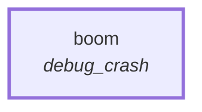

# Graph: `starter/crash`

**File**: `graphs/starter/crash.toml` · **nodes**: 1 · **edges**: 0 · **entry**: `boom` · **exit**: `—`

## What it is for

Deliberate crash trigger (F5.4 test seam), used only by scripts/phase3/crash.sh to exercise the daemon's panic hook.

## Shape

## Nodes

| node | kind | key configuration |
|---|---|---|
| `boom` | `debug_crash` | — |

## Edges

_No explicit edges._

## Composition

- **Callable**: no — no `exit` node, so it cannot be inlined by `call`
- **Calls**: nothing
- **Called by**: nothing

