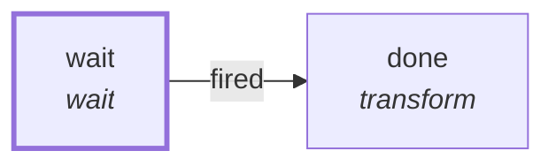

# Graph: `starter/slow`

**File**: `graphs/starter/slow.toml` · **nodes**: 2 · **edges**: 1 · **entry**: `wait` · **exit**: `—`

## What it is for

A deliberately long-running graph (F5.3 test seam), used only by scripts/phase3/shutdown.sh to have an active run in flight at SIGTERM.

## Shape

## Limits

`timer_ms=30000`

## Nodes

| node | kind | key configuration |
|---|---|---|
| `wait` | `wait` | — |
| `done` | `transform` | — |

## Edges

| from | port | to |
|---|---|---|
| `wait` | `fired` | `done` |

## Composition

- **Callable**: no — no `exit` node, so it cannot be inlined by `call`
- **Calls**: nothing
- **Called by**: nothing

