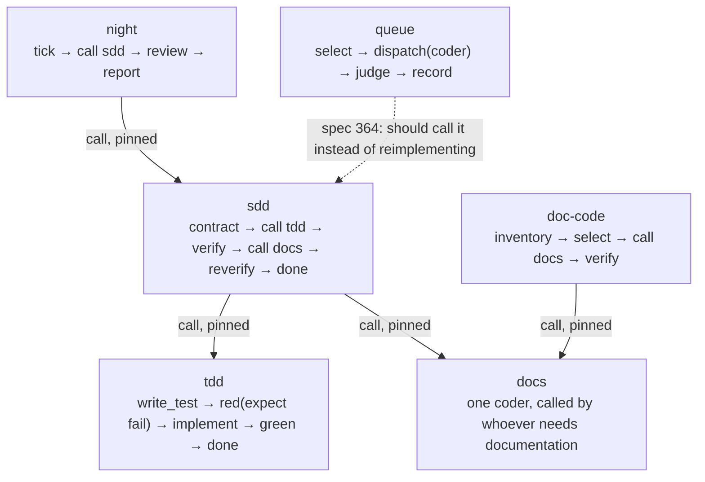

# How graphs compose

Composability is the feature this library exists for: a graph is assembled from parts that already exist, the way a
puzzle is assembled from pieces, and a graph can itself be a piece.

This page explains the mechanism, the three rules that keep it safe, what the library composes into today, and where
composition still runs out.

---

## 1. The unit: a node, and the port it leaves from

A node is a `kind` plus configuration. It does one thing and says how it went by leaving from a **named port**:

```toml
[[node]]
id   = "red"
kind = "judge"
expect = "fail"            # this judge is only satisfied when the criteria FAIL
```

A port is not a boolean. `select` has `ok`, `empty` and `blocked`; a coder has `ok` and `err`; a judge has `ok`, `fail`
and — in fail mode — `unrunnable`. **The names are the vocabulary**, which is why a graph reads like a sentence:

```toml
[[edge]] from = "red"  port = "ok"       to = "not-red"     # the test passed before the code: proves nothing
[[edge]] from = "red"  port = "fail"     to = "implement"   # a real RED
[[edge]] from = "red"  port = "unrunnable" to = "refused"   # exit 127 is neither
```

A graph adds: `entry`, `caps`, optionally `exit`, and `limits` (a wall clock).

## 2. The join: `call`

A node of kind `call` splices another graph into this one **at load time**. It is not a subprocess and not a
remote run: the callee's nodes become part of the host, and the callee's `exit` node becomes the call's return.

```toml
[[node]]
id    = "tdd"
kind  = "call"
graph = "tdd"                 # the callee, by its `name`
sha256 = "2eef3bb0144b1cba…"  # the exact revision of it you reviewed
caps  = ["spawn", "proc", "fs_read", "fs_write"]
```

Five things must hold, and the loader refuses the graph if any does not:

| requirement | why |
|---|---|
| the callee declares `exit` | otherwise there is nothing for the call to return |
| the callee's `needs` are supplied | `agent`, `model`, `provider`, `spec`, `workdir`, `brief` come from the host as `$.input.x` |
| the host's `caps` cover the callee's node caps | capability cannot be invented by being called |
| the `sha256` matches the callee on disk | a change to the callee invalidates the pin until someone re-pins it |
| `max_entries` is respected | a call is inlined N times, not looped |

The pin is the part people skip and it is the part that matters: **`night` cannot silently run a `queue` nobody
reviewed.** Re-pinning is a deliberate act, and it shows up in the diff as a hash change with one line of justification.

## 3. The three rules that make it safe

These are enforced by the daemon, not by convention:

1. **Capabilities are a ceiling.** A node may hold only what its graph holds. Measured 2026-11-03: a coder inside a
   graph with `caps = ["spawn","proc"]` had no write tool, stopped, and said so — instead of silently degrading.
2. **A `call` grants only what its host grants.** A callee needing `fs_write` inside a host that does not hold it is
   refused with `graph.call.widen`, naming the node and the missing capability.
3. **Only a graph with `exit` is a component.** A graph without one is a *run*, not a part. `queue` gained
   `exit = "record"` for exactly this (spec 343 R6); `spec` still lacks one, which is why it cannot be composed today.

## 4. What the library composes into now



Read it as three vocabularies layered:

- **tdd** knows nothing about SDD. It knows a test, a RED, an implementation and a GREEN. That is all.
- **sdd** knows a contract, a verification, a documentation step and three verdicts — and it gets the loop by
  *calling* tdd, not by reimplementing a coder and a judge.
- **night** knows time (`tick`) and telling someone (`post`) — and it gets the work by calling sdd.

That is the puzzle: each piece is usable on its own (`pii run start tdd`), and each larger piece is made of smaller
ones that did not change. `docs` is the sharpest example — one coder node, called by two different graphs, so
documentation has exactly one implementation.

## 5. Where composition runs out today

| gap | consequence | row |
|---|---|---|
| `queue` re-implements `spec` (a coder, then a judge) | two implementations of "implement a spec", and they can drift | 364 |
| `spec` declares no `exit` | it cannot be called, so the duplicate cannot be replaced yet | 364 |
| no planner node | the flow can implement and judge, but cannot author its own spec | 363 |
| no iteration primitive | `sdd` cannot run `tdd` **once per criterion**; a `foreach`/`map` over criteria is missing | — |
| models are per-node strings | composition is fine, but each piece can carry a different, possibly dead, model id | 362 |

The iteration gap is the interesting one. Composition is static today: the pieces are spliced at load time, so a graph
cannot say "do this call for each of these four criteria". Everything that needs repetition is currently written as
one node that loops internally (a judge running four commands), which is precisely why the judge has to know how to run
criteria at all.

## 6. A checklist for a new graph

1. Does a graph already do this? (`graphs/README.md`) — if yes, call it, do not copy it.
2. Does your graph need to be composed? If so, declare `exit`.
3. Grant `caps` for what your nodes need — no more. The ladder will catch a mismatch, loudly.
4. Pin every `call` by `sha256` and say in the commit why the pin moved.
5. One responsibility per graph. `tdd` is a loop; `sdd` is a process; `night` is a schedule.
6. If a step needs no model and no process, it is a `transform`, not a coder.
7. Every failure path gets a port with a name that says what happened — `not-red` is worth more than a boolean.

## The exit rule that surprises people (measured 2026-11-04)

A `call` returns through its callee's **exits**, and an exit is not the node the callee names in `exit`.
It is *every node that declares an `ok` port and has no outgoing `ok` edge*
(`crates/pii-graph/src/fragment/splice.rs`). The declared `exit` is the graph's own terminal for a direct run;
the splice uses the wider rule so a fragment with several natural endings still hands control back.

The consequence is sharp and it cost row 364 a night: `graphs/spec.toml` ends in three nodes — `done` (a transform,
declares `ok`, returned correctly) and `unverified` / `refused` (both `refuse` nodes, which declare no `ok`). So a
refused implementation **dead-ends inside the splice**: no edge fires, the run stops, and the queue row that called
it stays `Running` for ever instead of being recorded as parked.

Two ways out, and the choice is a design decision rather than a bug fix:

1. **The callee hands every verdict back** — make `unverified` and `refused` declare an `ok` port (or be transforms
   carrying a verdict value) so all three are exits; the host then has to distinguish them from the value that
   arrived, because all three return on the same port.
2. **The callee has one verdict node** — a single terminal node with ports `ok`, `unverified`, `refused`; the host
   wires each to the record it wants. Cleaner, and it makes the callee's outcome vocabulary explicit, but it changes
   `spec.toml`'s tail and every host that calls it.
