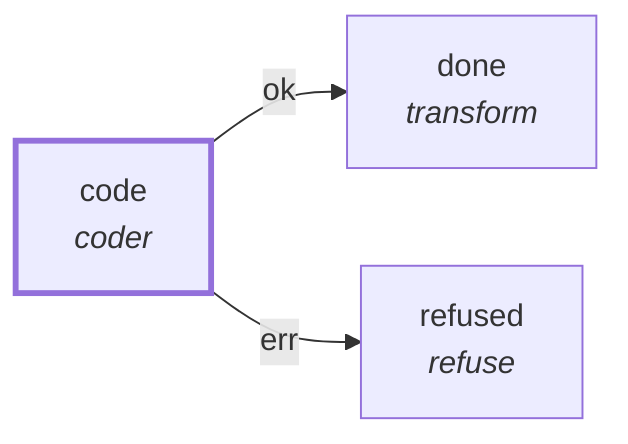

# Graph: `claude-probe`

**File**: `graphs/claude-probe.toml` · **nodes**: 3 · **edges**: 2 · **entry**: `code` · **exit**: `—`

## What it is for

Claude + haiku probe through pii: ONE turn, hard-capped, scratch workdir. No criteria, so the verdict is the exit code. Credential: claude reads its own login file through HOME (env_pass carries the NAME only; no value lives here).

## Shape

## Capabilities it holds

`["spawn", "proc"]` — a node may hold only what its graph holds, and a `call` may grant only what its host grants. The ladder is enforced, not advisory.

## Limits

`max_budget_usd=0`, `timeout_ms=180000`

## Nodes

| node | kind | key configuration |
|---|---|---|
| `code` | `coder` | agent=`claude` · model=`haiku` · workdir=`/projects/pi-improved/_tmp/claude-probe-work` · spec=`specs/207-the-coder-node-spawns-an-agent.md` · caps=`["spawn", "proc"]` |
| `done` | `transform` | — |
| `refused` | `refuse` | — |

## Edges

| from | port | to |
|---|---|---|
| `code` | `ok` | `done` |
| `code` | `err` | `refused` |

## Composition

- **Callable**: no — no `exit` node, so it cannot be inlined by `call`
- **Calls**: nothing
- **Called by**: nothing

