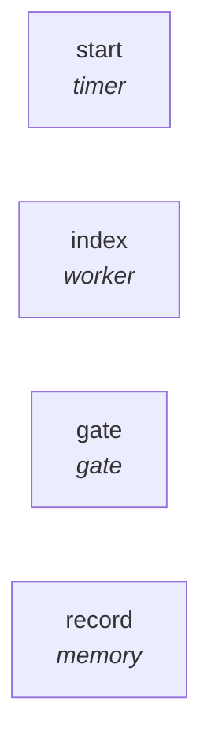

# Graph: `code-index`

**File**: `graphs/code-index.toml` · **nodes**: 4 · **edges**: 0 · **entry**: `—` · **exit**: `—`

## What it is for

code-index.toml — pii indexes its own codebase, AS A GRAPH. User directive 2026-10-19: "the graphify feature! initially indexing its own codebase" and "the respective graphs must also be modified accordingly". So the index is not only a script: it is a scheduled graph, like every other capability. PRODUCTION-DEPENDENCY NOTE (user rule 2026-10-19: companion scripts are fine in DEVELOPMENT, but pro…

## Shape

## Nodes

| node | kind | key configuration |
|---|---|---|
| `start` | `timer` | — |
| `index` | `worker` | agent=`claude` · model=`claude-haiku-5-5` · workdir=`/projects/pi-improved` |
| `gate` | `gate` | — |
| `record` | `memory` | — |

## Edges

_No explicit edges._

## Composition

- **Callable**: no — no `exit` node, so it cannot be inlined by `call`
- **Calls**: nothing
- **Called by**: nothing

