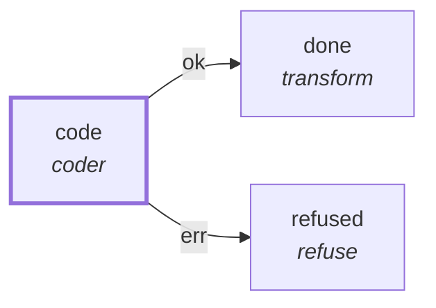

# Graph: `coder-selffix`

**File**: `graphs/coder-selffix.toml` · **nodes**: 3 · **edges**: 2 · **entry**: `code` · **exit**: `—`

## What it is for

demo (no fragment attach: the daemon cannot weave yet — row A87): one `coder` node spawns the pi agent on a spec, and its verdict is the run of its criteria. Only the NAMES in env_pass are copied from the daemon's environment; no credential value lives in this file.

## Shape

## Capabilities it holds

`["spawn", "proc"]` — a node may hold only what its graph holds, and a `call` may grant only what its host grants. The ladder is enforced, not advisory.

## Limits

`max_wall_ms=2100000`, `timeout_ms=1800000`

## Nodes

| node | kind | key configuration |
|---|---|---|
| `code` | `coder` | agent=`pi` · model=`@workhorse` · workdir=`/projects/pi-improved` · spec=`specs/207-the-coder-node-spawns-an-agent.md` · caps=`["spawn", "proc"]` |
| `done` | `transform` | — |
| `refused` | `refuse` | — |

## Edges

| from | port | to |
|---|---|---|
| `code` | `ok` | `done` |
| `code` | `err` | `refused` |

## Composition

- **Callable**: no — no `exit` node, so it cannot be inlined by `call`
- **Calls**: nothing
- **Called by**: nothing

