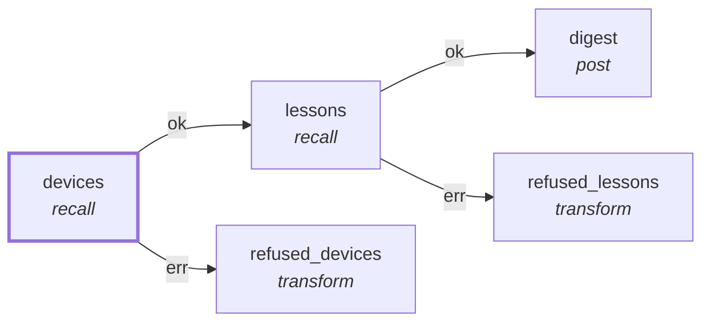

# Graph: `digest-now`

**File**: `graphs/digest-now.toml` · **nodes**: 5 · **edges**: 4 · **entry**: `devices` · **exit**: `—`

## What it is for

The digest, NOW: the same two reads and the same post as `discord-digest.toml`, with the timer removed. WHY A SECOND GRAPH RATHER THAN A FLAG. `discord-digest`'s entry node is a `timer`, so asking it to run answers "suspended, in_ms ≈ 44 178 269" — it cannot answer *now* by construction. The standing decision (2026-11-02) is that the digest is asked for, not scheduled: 1a/1b/1c are valuable when …

## Shape

## Capabilities it holds

`["memory_read", "post"]` — a node may hold only what its graph holds, and a `call` may grant only what its host grants. The ladder is enforced, not advisory.

## Limits

`limit=50`, `timeout_ms=5000`

## Nodes

| node | kind | key configuration |
|---|---|---|
| `devices` | `recall` | — |
| `lessons` | `recall` | — |
| `digest` | `post` | caps=`["post"]` |
| `refused_devices` | `transform` | — |
| `refused_lessons` | `transform` | — |

## Edges

| from | port | to |
|---|---|---|
| `devices` | `ok` | `lessons` |
| `lessons` | `ok` | `digest` |
| `devices` | `err` | `refused_devices` |
| `lessons` | `err` | `refused_lessons` |

## Composition

- **Callable**: no — no `exit` node, so it cannot be inlined by `call`
- **Calls**: nothing
- **Called by**: nothing

