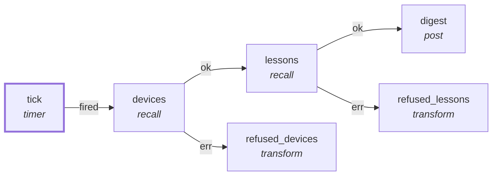

# Graph: `discord-digest`

**File**: `graphs/discord-digest.toml` · **nodes**: 6 · **edges**: 5 · **entry**: `tick` · **exit**: `—`

## What it is for

R3b: gather what the memory graph knows and post a digest into a Discord thread. INPUTS (stated, not implied): two `recall` reads of the entity store (spec 126) — entities of kind "device" and of kind "lesson", ranked so tiers apply (spec 127). The run input carries the destination: `{ "to": "<thread id inside the forum>" }`. NOT inputs: `pii learn list` candidates, memory tier counts and recent …

## Shape

## Capabilities it holds

`["memory_read", "post"]` — a node may hold only what its graph holds, and a `call` may grant only what its host grants. The ladder is enforced, not advisory.

## Limits

`limit=50`, `timeout_ms=5000`

## Nodes

| node | kind | key configuration |
|---|---|---|
| `tick` | `timer` | — |
| `devices` | `recall` | — |
| `lessons` | `recall` | — |
| `digest` | `post` | caps=`["post"]` |
| `refused_devices` | `transform` | — |
| `refused_lessons` | `transform` | — |

## Edges

| from | port | to |
|---|---|---|
| `tick` | `fired` | `devices` |
| `devices` | `ok` | `lessons` |
| `lessons` | `ok` | `digest` |
| `devices` | `err` | `refused_devices` |
| `lessons` | `err` | `refused_lessons` |

## Composition

- **Callable**: no — no `exit` node, so it cannot be inlined by `call`
- **Calls**: nothing
- **Called by**: nothing

