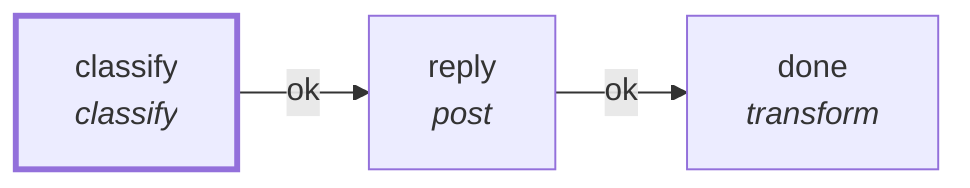

# Graph: `discord-triage`

**File**: `graphs/discord-triage.toml` · **nodes**: 3 · **edges**: 2 · **entry**: `classify` · **exit**: `—`

## What it is for

R3a: triage a Discord message with rules, no model. The channel ingress starts this graph per message (input: text, chat, user, channel); `classify` sorts the text into question | status | spec | alert | done (anything else is `chat`); `reply` posts the class back into the SAME thread (`to = $.input.chat`); `done` records the outcome and ends with text = "" so the router's automatic reply stays s…

## Shape

## Capabilities it holds

`["post"]` — a node may hold only what its graph holds, and a `call` may grant only what its host grants. The ladder is enforced, not advisory.

## Limits

`timeout_ms=5000`

## Nodes

| node | kind | key configuration |
|---|---|---|
| `classify` | `classify` | — |
| `reply` | `post` | caps=`["post"]` |
| `done` | `transform` | — |

## Edges

| from | port | to |
|---|---|---|
| `classify` | `ok` | `reply` |
| `reply` | `ok` | `done` |

## Composition

- **Callable**: no — no `exit` node, so it cannot be inlined by `call`
- **Calls**: nothing
- **Called by**: nothing

