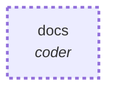

# Graph: `docs`

**File**: `graphs/docs.toml` · **nodes**: 1 · **edges**: 0 · **entry**: `docs` · **exit**: `docs`

## What it is for

the documentation step, a CALLED graph. `spec.toml` calls it after `verify` passes, and re-verifies after it, so a docs step that breaks the criteria is refused. It holds no budget, session or criteria: the budget stays the host's and the verdict is the host's `reverify`. No absolute path and no credential lives in this file.

## Shape

## Capabilities it holds

`["spawn", "proc"]` — a node may hold only what its graph holds, and a `call` may grant only what its host grants. The ladder is enforced, not advisory.

## Limits

`timeout_ms=1200000`

## Nodes

| node | kind | key configuration |
|---|---|---|
| `docs` | `coder` | agent=`$.input.agent` · model=`$.input.model` · provider=`$.input.provider` · workdir=`$.input.workdir` · spec=`$.input.spec` · caps=`["spawn", "proc"]` |

## Edges

_No explicit edges._

## Composition

- **Callable**: yes — it declares `exit = "docs"`
- **Calls**: nothing
- **Called by**: `spec` (node `docs`)

