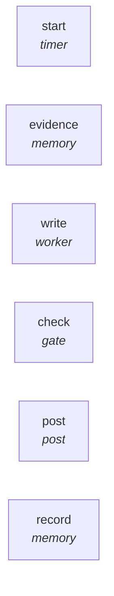

# Graph: `intervention-report`

**File**: `graphs/intervention-report.toml` · **nodes**: 6 · **edges**: 0 · **entry**: `—` · **exit**: `—`

## What it is for

intervention-report.toml — document and report an intervention, AS A GRAPH. The rule (user, 2026-10-18): "everything is a graph". So the report is not a document someone remembers to write — it is a run: recall what actually happened, have a worker turn it into a dated report, gate the report on the sections that make it honest, post it, and store it so the NEXT intervention starts from evidence …

## Shape

## Limits

`limit=40`

## Nodes

| node | kind | key configuration |
|---|---|---|
| `start` | `timer` | — |
| `evidence` | `memory` | — |
| `write` | `worker` | agent=`pi` · model=`deepseek-v4-flash` · workdir=`/projects/pi-improved` |
| `check` | `gate` | — |
| `post` | `post` | — |
| `record` | `memory` | — |

## Edges

_No explicit edges._

## Composition

- **Callable**: no — no `exit` node, so it cannot be inlined by `call`
- **Calls**: nothing
- **Called by**: nothing

