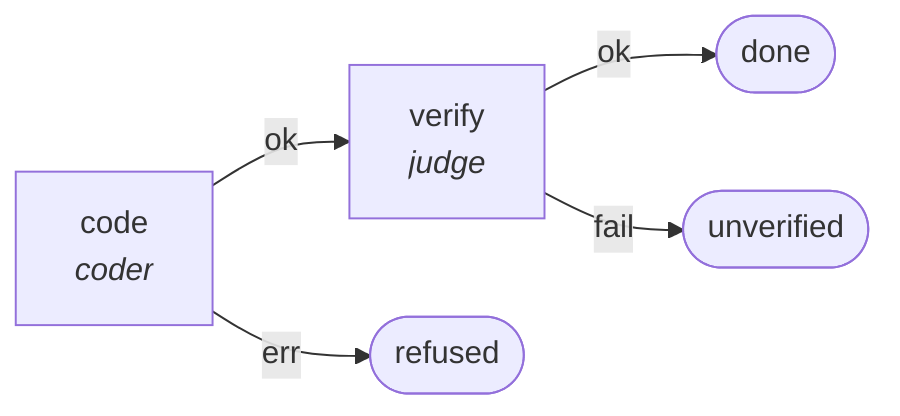

# Graph: `method-judge`

**File**: `graphs/method-judge.toml` · **entry**: `code` · **exit**: `done`

## What it is for

The judge methodology: a coder implements the spec, then the judge proves its criteria. It is one of two methodologies
the driver `spec` can select (the other is `sdd`, which proves RED before GREEN). It has no docs step: `spec` documents
the work and re-judges the criteria after this graph returns `ok`.

## Shape

## Verdicts

- `done`: the coder finished and the criteria pass.
- `unverified`: the criteria fail.
- `refused`: the coder failed to run.

Both refusals are wired by name in `spec.toml` (`method-judge.unverified`, `method-judge.refused`), so a caller of
`spec` sees the same three verdicts whichever methodology ran.

## Pin

`spec` calls this graph by `sha256`. A change to `method-judge.toml` changes its digest, and `spec` must be re-pinned.
