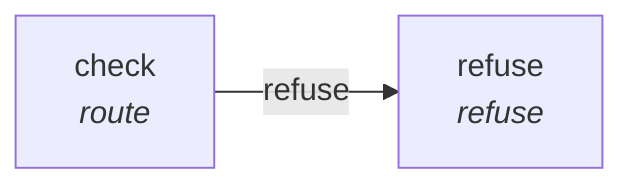

# Graph: `podman-guard`

**File**: `graphs/fragments/podman-guard.toml` · **nodes**: 2 · **edges**: 1 · **entry**: `—` · **exit**: `—`

## What it is for

fragment: a blocking guard. It refuses a run whose input asks for podman and passes every other run. Attach it by name with a sha256 pin. It may attach at a pre surface (run.start, node.before) because it may block.

## Shape

## Nodes

| node | kind | key configuration |
|---|---|---|
| `check` | `route` | — |
| `refuse` | `refuse` | — |

## Edges

| from | port | to |
|---|---|---|
| `check` | `refuse` | `refuse` |

## Composition

- **Callable**: no — no `exit` node, so it cannot be inlined by `call`
- **Calls**: nothing
- **Called by**: nothing

