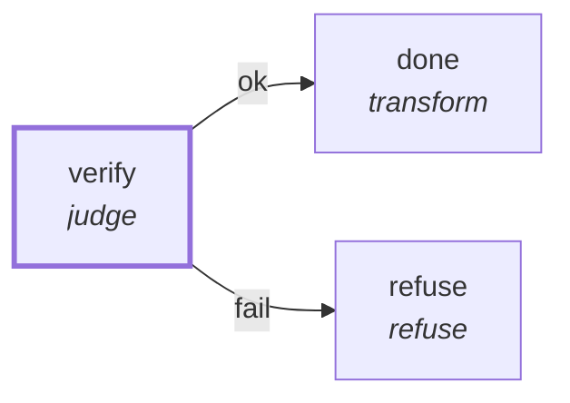

# Graph: `preflight`

**File**: `graphs/preflight.toml` · **nodes**: 3 · **edges**: 2 · **entry**: `verify` · **exit**: `—`

## What it is for

the preflight's one-node graph. The lane runs it through the daemon before the real run starts: the judge's sandbox is the real judge's, so a criterion that cannot write the scratch refuses here, for no agent and no spend. The run input names the throwaway spec (spec, base, workdir); the lane builds that repo under _tmp/devbox-test/ and passes the input with `run start preflight --input`.

## Shape

## Capabilities it holds

`["proc"]` — a node may hold only what its graph holds, and a `call` may grant only what its host grants. The ladder is enforced, not advisory.

## Limits

`max_wall_ms=600000`

## Nodes

| node | kind | key configuration |
|---|---|---|
| `verify` | `judge` | workdir=`$.input.workdir` · spec=`$.input.spec` · caps=`["proc"]` |
| `done` | `transform` | — |
| `refuse` | `refuse` | — |

## Edges

| from | port | to |
|---|---|---|
| `verify` | `ok` | `done` |
| `verify` | `fail` | `refuse` |

## Composition

- **Callable**: no — no `exit` node, so it cannot be inlined by `call`
- **Calls**: nothing
- **Called by**: nothing

