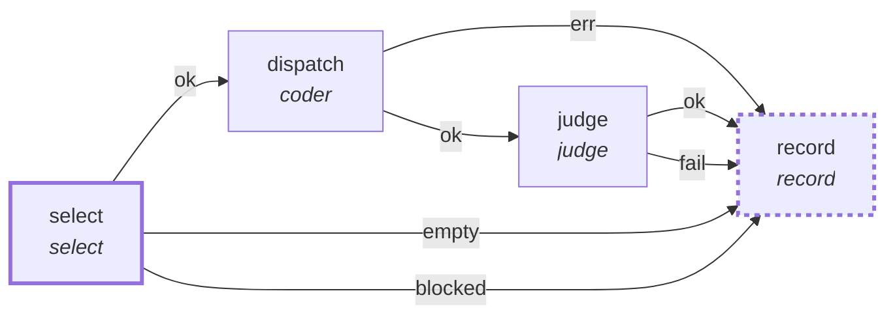

# Graph: `queue`

**File**: `graphs/queue.toml` · **nodes**: 4 · **edges**: 7 · **entry**: `select` · **exit**: `record`

## What it is for

the development queue as a graph. `select` gates the next work item (blocked and empty are reported apart, and a blocked select ends the run on its own port with the edge it waits on); `dispatch` is a coder node that works the selected item's spec; `judge` runs the item's criteria; `record` writes the verdict to the item's status in the queue store. A worker never commits: that stays an operator …

## Shape

## Capabilities it holds

`["spawn", "proc", "fs_read", "fs_write"]` — a node may hold only what its graph holds, and a `call` may grant only what its host grants. The ladder is enforced, not advisory.

## Limits

`max_wall_ms=3600000`, `timeout_ms=1800000`

## Nodes

| node | kind | key configuration |
|---|---|---|
| `select` | `select` | — |
| `dispatch` | `coder` | agent=`pi` · model=`@workhorse` · workdir=`$.input.workdir` · spec=`$.nodes.select.item.spec` · caps=`["spawn", "proc", "fs_read", "fs_write"]` |
| `judge` | `judge` | workdir=`$.input.workdir` · caps=`["proc"]` |
| `record` | `record` | — |

## Edges

| from | port | to |
|---|---|---|
| `select` | `ok` | `dispatch` |
| `dispatch` | `ok` | `judge` |
| `dispatch` | `err` | `record` |
| `judge` | `ok` | `record` |
| `judge` | `fail` | `record` |
| `select` | `empty` | `record` |
| `select` | `blocked` | `record` |

## Composition

- **Callable**: yes — it declares `exit = "record"`
- **Calls**: nothing
- **Called by**: `night` (node `sdd`)

