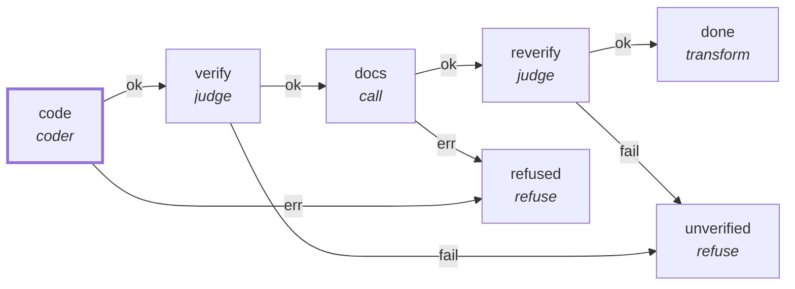

# Graph: `spec`

**File**: `graphs/spec.toml` · **nodes**: 7 · **edges**: 8 · **entry**: `code` · **exit**: `—`

## What it is for

one tracked graph implements any spec. The run input chooses the agent, model, spec, workdir and brief: pii run start spec --input '{"agent":"pi","model":"<model>","provider":"<provider>","spec":"specs/N-x.md","workdir":"<dir>","brief":"<text>"}' No absolute path and no credential lives in this file: only the NAMES in env_pass are copied from the daemon's environment.

## Shape

## Capabilities it holds

`["spawn", "proc"]` — a node may hold only what its graph holds, and a `call` may grant only what its host grants. The ladder is enforced, not advisory.

## Limits

`max_micro_usd=1000000`, `max_wall_ms=6000000`, `timeout_ms=3000000`

## Nodes

| node | kind | key configuration |
|---|---|---|
| `code` | `coder` | agent=`$.input.agent` · model=`$.input.model` · provider=`$.input.provider` · workdir=`$.input.workdir` · spec=`$.input.spec` · caps=`["spawn", "proc"]` |
| `verify` | `judge` | workdir=`$.input.workdir` · spec=`$.input.spec` · caps=`["proc"]` |
| `docs` | `call` | graph=`docs` · caps=`["spawn", "proc"]` · pin=`b7f8eacdb79aa051…` |
| `reverify` | `judge` | workdir=`$.input.workdir` · spec=`$.input.spec` · caps=`["proc"]` |
| `done` | `transform` | — |
| `unverified` | `refuse` | — |
| `refused` | `refuse` | — |

## Edges

| from | port | to |
|---|---|---|
| `code` | `ok` | `verify` |
| `verify` | `ok` | `docs` |
| `docs` | `ok` | `reverify` |
| `docs` | `err` | `refused` |
| `reverify` | `ok` | `done` |
| `reverify` | `fail` | `unverified` |
| `verify` | `fail` | `unverified` |
| `code` | `err` | `refused` |

## Composition

- **Callable**: no — no `exit` node, so it cannot be inlined by `call`
- **Calls**: `docs` from node `docs` (pinned b7f8eacdb79a…)
- **Called by**: nothing

