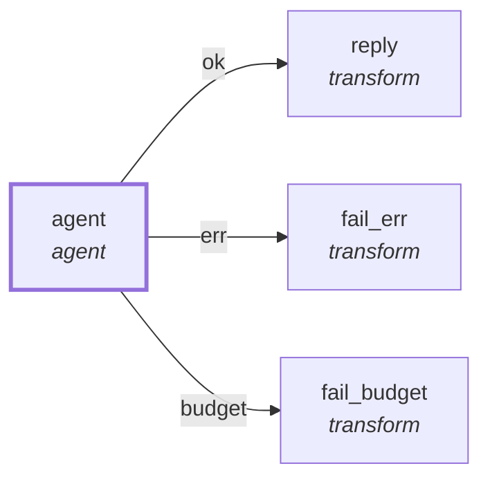

# Graph: `starter/assistant`

**File**: `graphs/starter/assistant.toml` · **nodes**: 4 · **edges**: 3 · **entry**: `agent` · **exit**: `—`

## What it is for

_No header comment in the file._

## Shape

## Capabilities it holds

`["fs_read", "fs_write", "proc", "net"]` — a node may hold only what its graph holds, and a `call` may grant only what its host grants. The ladder is enforced, not advisory.

## Limits

`max_steps=1000`, `max_wall_ms=600000`, `max_turns=4`

## Nodes

| node | kind | key configuration |
|---|---|---|
| `agent` | `agent` | caps=`["fs_read", "fs_write", "proc", "net"]` |
| `reply` | `transform` | — |
| `fail_err` | `transform` | — |
| `fail_budget` | `transform` | — |

## Edges

| from | port | to |
|---|---|---|
| `agent` | `ok` | `reply` |
| `agent` | `err` | `fail_err` |
| `agent` | `budget` | `fail_budget` |

## Composition

- **Callable**: no — no `exit` node, so it cannot be inlined by `call`
- **Calls**: nothing
- **Called by**: nothing

