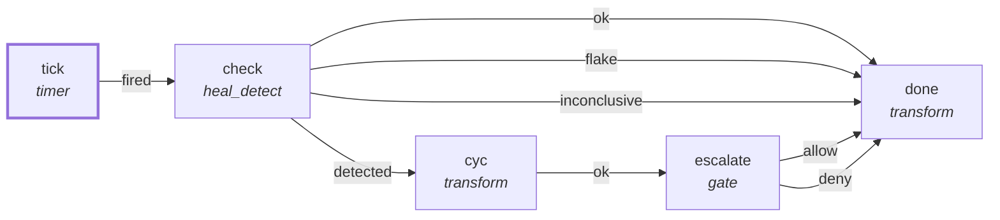

# Graph: `starter/boss-watch`

**File**: `graphs/starter/boss-watch.toml` · **nodes**: 5 · **edges**: 8 · **entry**: `tick` · **exit**: `—`

## What it is for

Boss watch (spec 27): the self-improving boss's WATCH loop as a real pii graph run on the daemon — dogfooding (008 §3/§4). Every 30 min it runs the silent-noop-check gate (spec 24) on the daemon itself; a detected failure escalates through a `gate` node so a human approves before anything heals. No FS_WRITE anywhere in this graph (heal_detect is read-only detection; the gate node itself is PURE).…

## Shape

## Capabilities it holds

`["proc"]` — a node may hold only what its graph holds, and a `call` may grant only what its host grants. The ladder is enforced, not advisory.

## Limits

`max_steps=1000`, `max_wall_ms=600000`

## Nodes

| node | kind | key configuration |
|---|---|---|
| `tick` | `timer` | — |
| `check` | `heal_detect` | caps=`["proc"]` |
| `cyc` | `transform` | — |
| `escalate` | `gate` | — |
| `done` | `transform` | — |

## Edges

| from | port | to |
|---|---|---|
| `tick` | `fired` | `check` |
| `check` | `ok` | `done` |
| `check` | `flake` | `done` |
| `check` | `inconclusive` | `done` |
| `check` | `detected` | `cyc` |
| `cyc` | `ok` | `escalate` |
| `escalate` | `allow` | `done` |
| `escalate` | `deny` | `done` |

## Composition

- **Callable**: no — no `exit` node, so it cannot be inlined by `call`
- **Calls**: nothing
- **Called by**: nothing

