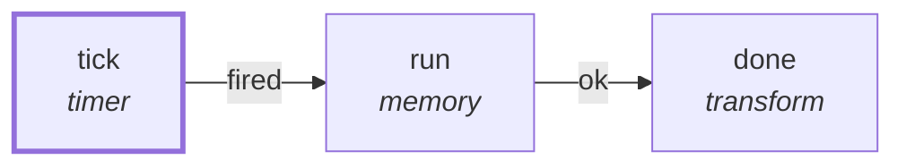

# Graph: `starter/consolidate`

**File**: `graphs/starter/consolidate.toml` · **nodes**: 3 · **edges**: 2 · **entry**: `tick` · **exit**: `—`

## What it is for

_No header comment in the file._

## Shape

## Limits

`max_steps=1000`, `max_wall_ms=600000`, `max_tokens=100000`, `max_model_calls=10`

## Nodes

| node | kind | key configuration |
|---|---|---|
| `tick` | `timer` | — |
| `run` | `memory` | — |
| `done` | `transform` | — |

## Edges

| from | port | to |
|---|---|---|
| `tick` | `fired` | `run` |
| `run` | `ok` | `done` |

## Composition

- **Callable**: no — no `exit` node, so it cannot be inlined by `call`
- **Calls**: nothing
- **Called by**: nothing

