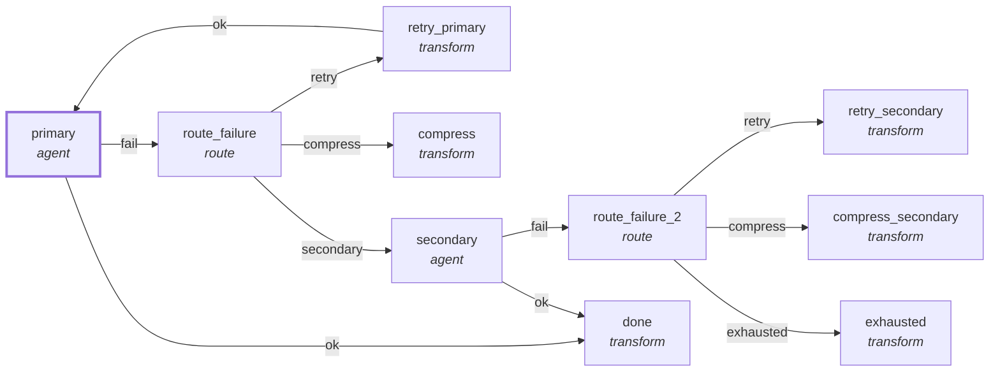

# Graph: `starter/failover`

**File**: `graphs/starter/failover.toml` · **nodes**: 10 · **edges**: 11 · **entry**: `primary` · **exit**: `—`

## What it is for

Spec-41 (Phase 5.1 Track A4): failover ladder — two sequential model nodes, each retried on a transient failure and advanced to the next provider on anything else. `compress`/`exhausted` are deliberate dead ends: `Compress` reasons are not fixed by retrying or switching provider (the payload is still too large), and a `secondary` exhaustion means the chain has nothing left to try (`crates/pii-abi…

## Shape

## Capabilities it holds

`["fs_read", "fs_write", "proc"]` — a node may hold only what its graph holds, and a `call` may grant only what its host grants. The ladder is enforced, not advisory.

## Limits

`max_steps=1000`, `max_wall_ms=600000`, `max_tokens=20000`, `loop_budget=3`

## Nodes

| node | kind | key configuration |
|---|---|---|
| `primary` | `agent` | — |
| `route_failure` | `route` | — |
| `retry_primary` | `transform` | — |
| `compress` | `transform` | — |
| `secondary` | `agent` | — |
| `route_failure_2` | `route` | — |
| `retry_secondary` | `transform` | — |
| `compress_secondary` | `transform` | — |
| `exhausted` | `transform` | — |
| `done` | `transform` | — |

## Edges

| from | port | to |
|---|---|---|
| `primary` | `ok` | `done` |
| `primary` | `fail` | `route_failure` |
| `route_failure` | `retry` | `retry_primary` |
| `retry_primary` | `ok` | `primary` |
| `route_failure` | `compress` | `compress` |
| `route_failure` | `secondary` | `secondary` |
| `secondary` | `ok` | `done` |
| `secondary` | `fail` | `route_failure_2` |
| `route_failure_2` | `retry` | `retry_secondary` |
| `route_failure_2` | `compress` | `compress_secondary` |
| `route_failure_2` | `exhausted` | `exhausted` |

## Composition

- **Callable**: no — no `exit` node, so it cannot be inlined by `call`
- **Calls**: nothing
- **Called by**: nothing

