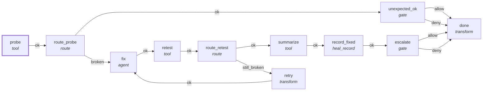

# Graph: `starter/heal-fix`

**File**: `graphs/starter/heal-fix.toml` · **nodes**: 11 · **edges**: 14 · **entry**: `probe` · **exit**: `—`

## What it is for

Slice-1 heal-fix graph (S1.3): localize -> patch -> validate -> escalate. Runs in a disposable worktree; the run's ctx fs_write PathScope IS the worktree (scope_root in run input) — confinement is a capability, not a policy. The fix agent has fs/edit tools ONLY (NO bash): every write it makes goes through Ctx::fs() and is mechanically bound to the worktree. bash runs only in `tool` nodes, from hu…

## Shape

## Capabilities it holds

`["fs_read", "fs_write", "proc"]` — a node may hold only what its graph holds, and a `call` may grant only what its host grants. The ladder is enforced, not advisory.

## Limits

`max_steps=1000`, `max_wall_ms=600000`, `max_tokens=20000`, `loop_budget=2`, `max_turns=6`

## Nodes

| node | kind | key configuration |
|---|---|---|
| `probe` | `tool` | — |
| `route_probe` | `route` | — |
| `unexpected_ok` | `gate` | — |
| `fix` | `agent` | — |
| `retest` | `tool` | — |
| `route_retest` | `route` | — |
| `retry` | `transform` | — |
| `summarize` | `tool` | — |
| `record_fixed` | `heal_record` | — |
| `escalate` | `gate` | — |
| `done` | `transform` | — |

## Edges

| from | port | to |
|---|---|---|
| `probe` | `ok` | `route_probe` |
| `route_probe` | `ok` | `unexpected_ok` |
| `route_probe` | `broken` | `fix` |
| `fix` | `ok` | `retest` |
| `retest` | `ok` | `route_retest` |
| `route_retest` | `ok` | `summarize` |
| `route_retest` | `still_broken` | `retry` |
| `retry` | `ok` | `fix` |
| `summarize` | `ok` | `record_fixed` |
| `record_fixed` | `ok` | `escalate` |
| `escalate` | `allow` | `done` |
| `escalate` | `deny` | `done` |
| `unexpected_ok` | `allow` | `done` |
| `unexpected_ok` | `deny` | `done` |

## Composition

- **Callable**: no — no `exit` node, so it cannot be inlined by `call`
- **Calls**: nothing
- **Called by**: nothing

