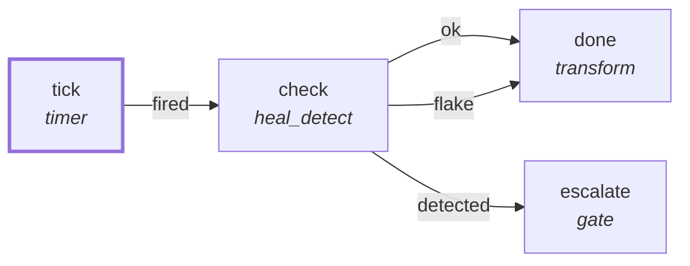

# Graph: `starter/heal-watch`

**File**: `graphs/starter/heal-watch.toml` · **nodes**: 4 · **edges**: 4 · **entry**: `tick` · **exit**: `—`

## What it is for

S0.3 heal-watch: every 30 min run the quality gate; a reproducible failure (fails twice) writes ONE heal_attempt ledger row and suspends on a `gate` node for human acknowledgement. No patching, no FS_WRITE anywhere in this graph (guardrail: heal_detect is read-only detection).

## Shape

## Capabilities it holds

`["proc"]` — a node may hold only what its graph holds, and a `call` may grant only what its host grants. The ladder is enforced, not advisory.

## Limits

`max_steps=1000`, `max_wall_ms=600000`

## Nodes

| node | kind | key configuration |
|---|---|---|
| `tick` | `timer` | — |
| `check` | `heal_detect` | caps=`["proc"]` |
| `escalate` | `gate` | — |
| `done` | `transform` | — |

## Edges

| from | port | to |
|---|---|---|
| `tick` | `fired` | `check` |
| `check` | `ok` | `done` |
| `check` | `flake` | `done` |
| `check` | `detected` | `escalate` |

## Composition

- **Callable**: no — no `exit` node, so it cannot be inlined by `call`
- **Calls**: nothing
- **Called by**: nothing

