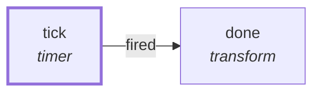

# Graph: `starter/soak_cron`

**File**: `graphs/starter/soak_cron.toml` · **nodes**: 2 · **edges**: 1 · **entry**: `tick` · **exit**: `—`

## What it is for

_No header comment in the file._

## Shape

## Limits

`max_steps=100`, `max_wall_ms=600000`

## Nodes

| node | kind | key configuration |
|---|---|---|
| `tick` | `timer` | — |
| `done` | `transform` | — |

## Edges

| from | port | to |
|---|---|---|
| `tick` | `fired` | `done` |

## Composition

- **Callable**: no — no `exit` node, so it cannot be inlined by `call`
- **Calls**: nothing
- **Called by**: nothing

