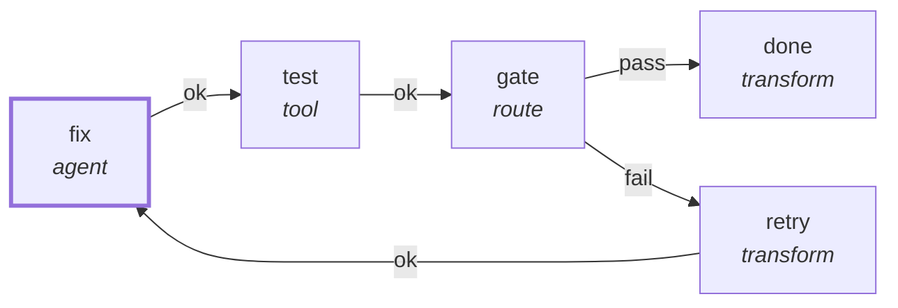

# Graph: `starter/verify-fix`

**File**: `graphs/starter/verify-fix.toml` · **nodes**: 5 · **edges**: 5 · **entry**: `fix` · **exit**: `—`

## What it is for

_No header comment in the file._

## Shape

## Capabilities it holds

`["fs_read", "fs_write", "proc"]` — a node may hold only what its graph holds, and a `call` may grant only what its host grants. The ladder is enforced, not advisory.

## Limits

`loop_budget=3`, `max_turns=24`, `compact_at_tokens=24000`

## Nodes

| node | kind | key configuration |
|---|---|---|
| `fix` | `agent` | caps=`["fs_read", "fs_write", "proc"]` |
| `test` | `tool` | — |
| `gate` | `route` | — |
| `done` | `transform` | — |
| `retry` | `transform` | — |

## Edges

| from | port | to |
|---|---|---|
| `fix` | `ok` | `test` |
| `test` | `ok` | `gate` |
| `gate` | `pass` | `done` |
| `gate` | `fail` | `retry` |
| `retry` | `ok` | `fix` |

## Composition

- **Callable**: no — no `exit` node, so it cannot be inlined by `call`
- **Calls**: nothing
- **Called by**: nothing

