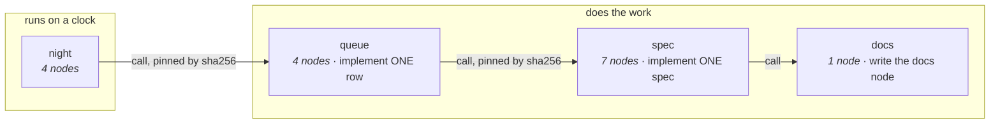
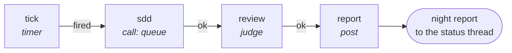
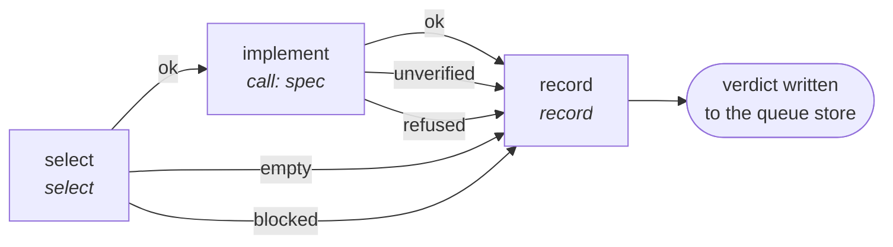
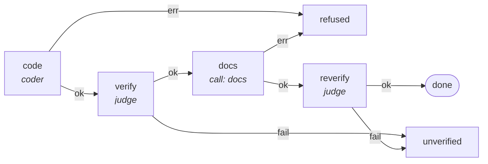
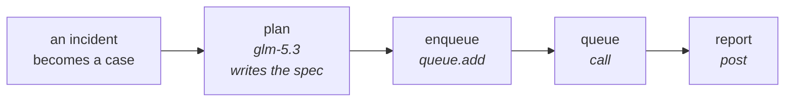

# The graphs

A **graph** is a small program written as data: nodes that do work, ports that say how it went, and edges that
connect them. pii runs it on the daemon, keeps a journal of every state change, and can suspend and resume it.

This folder is the library. `graphs/DOCS/` has one page per graph, generated from the files themselves — nodes,
kinds, configuration, edges, capabilities. This page is the index: what each graph is for, how they compose, and
the four flows that matter.

## How to read a graph file

```toml
name  = "queue"                 # the name `pii run start queue` resolves; installed graphs are keyed by it
entry = "select"                # where a run begins
exit  = "record"                # REQUIRED for a graph to be callable by another graph's `call` node
caps  = ["spawn", "proc", "fs_read", "fs_write"]   # what the whole graph may hold

[[node]] id = "select" kind = "select"             # a node: a kind plus its configuration
[[edge]] from = "select" port = "ok" to = "dispatch"   # an edge: from a node, out of a port, into a node
```

Three rules the daemon enforces rather than documents:

1. **A node may hold only what its graph holds.** A coder that needs to write inside a graph whose `caps` are
   `["spawn","proc"]` is refused, not silently degraded. Measured 2026-11-03: the agent stopped with *"no write or
   execute tool is available"* and reported the block.
2. **A `call` may grant only what its host grants.** `night` calls `queue`, so `night` must hold what `queue` needs.
3. **A graph without an `exit` node cannot be called.** `queue` gained `exit = "record"` for exactly this (spec 343
   R6); `spec` still has none, which is why nothing can inline it yet (spec 364).

**How the pieces actually join** — `call`, pins, the capability ladder, what composition cannot do yet:
[COMPOSABILITY.md](COMPOSABILITY.md).

## The composition map

Only two `call` nodes exist in the whole library, and both are load-bearing:



`queue` calls `spec` (spec 364) — one implementation of "implement a spec", reached three ways: by hand, by the queue,
and by the self-improving flow.

## The four flows

### 1. The night — a timer, work, and a report



`night.toml` is the only graph a clock starts. Its `sdd` node **pins `queue` by sha256**, so a change to the queue
graph invalidates the pin until `night` is re-pinned — deliberate: the night cannot silently run a queue nobody
reviewed.

### 2. The queue — implement one row



`select` claims one work item and emits it at `$.nodes.select.item`; `implement` calls the spec graph **with that item's
spec**, and the callee's judges own the verdict: the row's own criteria are not run here. `record` writes the verdict,
and a refusal the host wires by name parks the row instead of failing the run. The run input needs `workdir` and `base`,
the commit that holds the row's spec. A worker never commits — that stays an operator act.

Every configuration around the coder was measured, and each was a defect before it was a line:

| field | why it is there |
|---|---|
| `spec = "$.nodes.select.item.spec"` | without it the coder had no document and improvised another spec's files |
| `model` + `provider` | the old id `deepseek-v4-flash` had not existed for months; the graph died at spawn |
| `caps` with `fs_read`/`fs_write` | a coder without them cannot implement anything |
| `env_pass` (in `spec.toml`) | a spawned agent inherits almost nothing: the key and the config dirs must be named |
| `timeout_ms` (in `spec.toml`) | a coder pass past ten minutes is normal; the default killed real work |

The agent side has two more, in the daemon rather than the graph: `--approval-mode yolo` (a headless run has no
approval surface, so every write was denied) and the spec path prefixed into the prompt (the agent was told
"the spec named above" with nothing named).

### 3. The spec — implement one spec, by hand



Three verdicts, not two: **done** (code and docs both verified), **unverified** (code written, criteria failed),
**refused** (the run could not proceed). `unverified` is the honest middle: work exists, it is not proven.

### 4. Documentation of the code — specified, not built

`graphs/docs.toml` is a **called** graph: a coder writes documentation for whatever brief the host gives it. It has no
inventory and no way to tell whether the document is true. **Spec 374** adds `graphs/doc-code.toml`, which composes it:
`inventory` → `select` (or `nothing-to-do`) → `call docs` → `verify` (every path and symbol the document names must
exist) → `done`.

### 5. The self-improving flow — not built yet



Today's pieces: incidents become cases (spec 350), a row can be put in the queue from outside (spec 352), and a
coder implements a row (queue). What is missing is the middle — a node that has a model write the spec — which is
**spec 363**, and the model naming that makes one place name every model (**spec 362**).

## Every graph, by role

Generated from the files; each name links to its page.

| graph | file | nodes | entry → exit | caps | what it is |
|---|---|---|---|---|---|
| [night](DOCS/night.md) | `graphs/night.toml` | 4 | `tick` → `report` | spawn, proc, post, fs_read, fs_write | the clock: timer → call queue (pinned) → report |
| [queue](DOCS/queue.md) | `graphs/queue.toml` | 4 | `select` → `record` | spawn, proc, fs_read, fs_write | implement one row: select → coder → judge → record |
| [spec](DOCS/spec.md) | `graphs/spec.toml` | 7 | `code` → — | spawn, proc | implement one spec: code → verify → docs → reverify |
| [docs](DOCS/docs.md) | `graphs/docs.toml` | 1 | `docs` → `docs` | spawn, proc | the docs node other graphs call |
| [code-index](DOCS/code-index.md) | `graphs/code-index.toml` | 4 | — → — | — | index the codebase |
| [claude-probe](DOCS/claude-probe.md) | `graphs/claude-probe.toml` | 3 | `code` → — | spawn, proc | probe an agent without spending a spec |
| [coder-demo](DOCS/coder-demo.md) | `graphs/coder-demo.toml` | 3 | `code` → — | spawn, proc | the smallest working coder graph |
| [coder-podman](DOCS/coder-podman.md) | `graphs/coder-podman.toml` | 3 | `code` → — | spawn, proc | the coder inside a container |
| [coder-selffix](DOCS/coder-selffix.md) | `graphs/coder-selffix.toml` | 3 | `code` → — | spawn, proc | the coder that fixes its own spec |
| [digest-now](DOCS/digest-now.md) | `graphs/digest-now.toml` | 5 | `devices` → — | memory_read, post | build a digest on demand |
| [discord-digest](DOCS/discord-digest.md) | `graphs/discord-digest.toml` | 6 | `tick` → — | memory_read, post | the scheduled digest |
| [discord-triage](DOCS/discord-triage.md) | `graphs/discord-triage.toml` | 3 | `classify` → — | post | classify and post an incoming message |
| [intervention-report](DOCS/intervention-report.md) | `graphs/intervention-report.toml` | 6 | — → — | — | report on an intervention |
| [preflight](DOCS/preflight.md) | `graphs/preflight.toml` | 3 | `verify` → — | proc | the pre-dispatch checks |
| [podman-guard](DOCS/podman-guard.md) | `graphs/fragments/podman-guard.toml` | 2 | — → — | — | a fragment, not a runnable graph |
| [starter/assistant](DOCS/starter__assistant.md) | `graphs/starter/assistant.toml` | 4 | `agent` → — | fs_read, fs_write, proc, net | sample: an assistant loop |
| [starter/boss-watch](DOCS/starter__boss-watch.md) | `graphs/starter/boss-watch.toml` | 5 | `tick` → — | proc | sample: watch a boss process |
| [starter/consolidate](DOCS/starter__consolidate.md) | `graphs/starter/consolidate.toml` | 3 | `tick` → — | — | sample: consolidate records |
| [starter/crash](DOCS/starter__crash.md) | `graphs/starter/crash.toml` | 1 | `boom` → — | — | sample: a node that fails on purpose |
| [starter/failover](DOCS/starter__failover.md) | `graphs/starter/failover.toml` | 10 | `primary` → — | fs_read, fs_write, proc | sample: fail over between paths |
| [starter/heal-fix](DOCS/starter__heal-fix.md) | `graphs/starter/heal-fix.toml` | 11 | `probe` → — | fs_read, fs_write, proc | sample: detect then fix |
| [starter/heal-watch](DOCS/starter__heal-watch.md) | `graphs/starter/heal-watch.toml` | 4 | `tick` → — | proc | sample: watch and heal |
| [starter/react](DOCS/starter__react.md) | `graphs/starter/react.toml` | 3 | `agent` → — | fs_read, fs_write, proc | sample: react to a signal |
| [starter/slow](DOCS/starter__slow.md) | `graphs/starter/slow.toml` | 2 | `wait` → — | — | sample: a slow node |
| [starter/soak](DOCS/starter__soak.md) | `graphs/starter/soak.toml` | 1 | `step` → — | — | sample: one soak step |
| [starter/soak_cron](DOCS/starter__soak_cron.md) | `graphs/starter/soak_cron.toml` | 2 | `tick` → — | — | sample: soak on a cron |
| [starter/verify-fix](DOCS/starter__verify-fix.md) | `graphs/starter/verify-fix.toml` | 5 | `fix` → — | fs_read, fs_write, proc | sample: fix then verify |

## Which graphs can be called

A graph is callable only if it declares an `exit`:

| callable | why |
|---|---|
| `night` (`exit = "report"`) | so another graph can run a night |
| `queue` (`exit = "record"`) | so `night` can call it (spec 343 R6) |
| `docs` (`exit = "docs"`) | so `spec` can call it |
| everything else | no `exit` node — a run, not a component |

Adding `exit` is the whole change needed to make a graph composable; that is why spec 364 makes `spec` declare one.

## Known defects this index exposes

- ~~`graphs/coder-selffix.toml` declared `name = "coder-demo"`~~ — **found by writing this index and fixed**: installed
  graphs are keyed by name, so the two files collided and `pii run start coder-selffix` resolved to nothing. The file
  now declares its own name.
- **`queue` re-implements `spec`** (a coder then a judge) instead of calling it — spec 364.
- **`spec` has no `exit`**, so it cannot be composed at all today.
