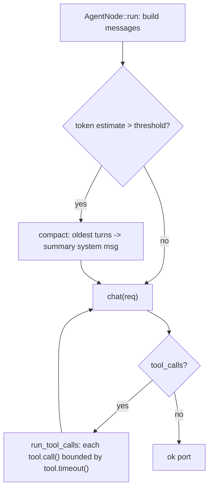

# pi-improved — spec-14: phase4-turn-loop-hardening-part2

- **Project**: `/projects/pi-improved`
- **Priority**: R1 (long-conversation death) is the #1 daily-use killer per the opus Phase-4 review — a long session returns a raw Ollama error or the model silently ignores the start of the conversation.
- **Status**: SPECIFIED — not yet dispatched · *(lifecycle: SPECIFIED → IN PROGRESS
  on dispatch → IMPLEMENTED — awaiting review → DONE after the orchestrator
  commits and updates HANDOFF.md)*
- **Source**: Phase 4.1b - compaction gate + per-tool timeouts (2026-09-07)
- **Depends-On**: spec 13 (4.1a) — landed `num_ctx` on `ChatRequest` (the compaction budget reference) and `run_child` cancel observation (F3). This spec builds on both.

---

## Verified Premises

- `crates/pii-server/src/agent.rs:111-122` — the turn loop builds `ChatRequest { messages: messages.clone(), num_ctx: 0, ... }` each turn; `messages` grows unbounded (every turn pushes assistant + tool messages) and is cloned in full every turn. No compaction exists.
- `crates/pii-server/src/agent.rs:107-109` — `messages` starts as `[System, ...history, User]`; `history_messages` seeds prior turns from the run input's `history`.
- `crates/pii-model/src/lib.rs:82-96` — `ChatRequest` now has `num_ctx: u32` (landed in 4.1a); `0` means "provider default" (`DEFAULT_NUM_CTX = 8192` in `ollama.rs:16`).
- `crates/pii-server/src/registry.rs:141-162` — `DEFAULT_TOML` declares NO `[limits]` section; `Limits::max_tokens` defaults to `u64::MAX` so the `budget` port can never catch a long conversation.
- `crates/pii-tools/src/bash.rs:69-80` — `BashTool` already reads `timeout_ms` from args (default 120s, capped 600s) and passes it to `ProcCap::run`. So bash already has a per-call timeout.
- `crates/pii-tools/src/lib.rs:23-35` — the `Tool` trait is `{ name, spec, call }`; there is NO per-tool timeout/concurrency metadata on the trait. `fs_read`/`edit`/`grep`/`glob` have no timeout concept (they're fast local ops).
- `crates/pii-tools/src/search.rs` — `grep`/`glob` walk the workspace recursively with no depth/size bound beyond the 64 KiB output cap; a huge tree could take long. (Landed in 4.1a.)
- `crates/pii-server/src/agent.rs:226-229` — `emit_live` sends `Event::AssistantDelta`-capable events to the bus; the delta pipeline (proto variant, bus routing, TUI renderer) exists but the PRODUCER is missing (`stream: false` in `ollama.rs:99`). Streaming is deferred to spec 15 (needs a streaming transport — a bigger change than the sync `HttpTransport` seam).

---

## Overview

The opus Phase-4 review's **R1** is the #1 daily-use killer: *"A long conversation dies, ungracefully. Every turn sends the full transcript; nothing compacts/truncates/counts tokens; `Limits::max_tokens` defaults to `u64::MAX` so the `budget` port can never catch it; `DEFAULT_TOML` declares no `[limits]`."* Turn 25 of a real session returns a raw Ollama error, or the model silently ignores the beginning of the conversation.

This spec fixes the two tractable halves of 4.1b:

1. **Compaction gate** — when the estimated token count of `messages` crosses a fraction of `num_ctx`, collapse the oldest turns into one summary system message and write the compacted transcript back to the session. This bounds the transcript so a long conversation stays within the model's context window.
2. **Per-tool timeouts** — add timeout metadata to the `Tool` trait so the agent loop can bound every tool call, not just `bash`. `bash` already has one; the gap is a *uniform* mechanism and a default for tools that could run long (e.g. `grep`/`glob` on a huge tree).

**Streaming is explicitly deferred to spec 15.** It needs a streaming transport (incremental chunk reads through `HttpTransport`), which is a larger architectural change than the sync seam allows. The delta pipeline already exists; only the producer is missing.

---

## Requirements

### Functional

- **R1 (compaction gate)**: `AgentNode::run` estimates the token count of `messages` before each model call. When it exceeds `compaction_threshold` (a fraction of `num_ctx`, default 0.5), collapse the oldest turns (everything before the last `max_turns`-worth of recent context) into a single summary system message, and continue with the compacted transcript. The compaction must preserve the current turn's user message and the most recent tool results.
- **R2 (compaction config)**: the agent node config gains `compaction_threshold` (fraction, default 0.5) and `compaction_min_turns` (default 4 — never compact a conversation shorter than this). `DEFAULT_TOML` gains a `[limits] max_tokens` so the `budget` port becomes reachable.
- **R3 (per-tool timeout metadata)**: the `Tool` trait gains a `timeout()` method returning `Option<Duration>` (default `None` = no bound). `BashTool` returns its configured timeout; `GrepTool`/`GlobTool` return a default (e.g. 30s) so a huge-tree walk can't hang the loop.
- **R4 (agent loop enforces tool timeouts)**: `AgentNode::run_tool_calls` wraps each `tool.call()` with the tool's declared timeout (via a bounded thread + `try_wait`-style join, or a deadline check), returning a `PiiError::Timeout` if the tool exceeds it. The loop must not hang on a slow tool.

### Non-Functional

- **N1**: existing behaviour must not change for short conversations — compaction only fires above the threshold; a 2-turn session is byte-identical to today.
- **N2**: no new runtime dependencies. Token estimation uses a simple heuristic (chars/4 or a per-message estimate), not a tokenizer crate.
- **N3**: the quality gate stays green; the test count may only go up.
- **N4**: `cargo xtask deps-check` and `cargo xtask net-check` still pass — no new dependency edges, no new socket code.

---

## Architecture

**Key decision — compaction collapses to a summary system message, not truncation.** Truncating the head of the transcript loses the system prompt's authority and the earliest user intent. Collapsing the oldest turns into one summary system message preserves the gist while bounding the token count. The summary is a plain `ChatMessage::new(Role::System, "Earlier context: ...")` — no model call to generate it (that would cost tokens and add latency); it's a deterministic condensation of the oldest turns' roles+content.

**Key decision — per-tool timeout via a trait method, not a wrapper.** Adding `timeout()` to the `Tool` trait lets each tool declare its own bound (bash: 120s; grep/glob: 30s; fs ops: none). The agent loop enforces it uniformly. Rejected: a blanket timeout in the loop (wrong for fast local ops) or a wrapper struct (loses the per-tool declaration).

**What this spec is not**: streaming (spec 15), session persistence (P4.2), memory v2 (P4.3). Those are separate specs.

---

## TDD Contract

| id | test | given | expects |
|----|------|-------|---------|
| R1 | `compaction_fires_above_threshold` (pii-server unit) | a `RecordingProvider`; a `messages` list whose estimated tokens exceed the threshold | the next `ChatRequest.messages` has a summary system message and a bounded length; the current user message is preserved |
| R1 | `compaction_skips_short_conversations` | a 2-turn session | `ChatRequest.messages` is byte-identical to today (no summary) |
| R1 | `compaction_preserves_recent_tool_results` | a long conversation with recent tool results | the last N tool results survive compaction; only the oldest turns are collapsed |
| R2 | `default_toml_has_limits` | `DEFAULT_TOML` | contains a `[limits] max_tokens` value |
| R3 | `tool_timeout_metadata` (pii-tools unit) | `BashTool`, `GrepTool`, `GlobTool`, `FsReadTool` | `timeout()` returns the declared bound (bash 120s, grep/glob 30s, fs None) |
| R4 | `slow_tool_times_out` (pii-server unit) | a fake tool whose `call()` sleeps 5s, declared timeout 100ms | `run_tool_calls` returns `PiiError::Timeout` within ~1s, does not hang |

**R1 is the acceptance test.** The requirement a plausible implementation gets wrong: it compacts by *truncating* the head (losing the system prompt) or compacts *every* turn (changing short-conversation behaviour). The test `compaction_skips_short_conversations` catches both.

---

## Exit Criteria

- [ ] `cargo build --workspace --all-targets` — compiles (R1-R4)
- [ ] `cargo test -p pii-server compaction` — compaction tests pass (R1, R2)
- [ ] `cargo test -p pii-tools tool_timeout` — timeout metadata tests pass (R3)
- [ ] `cargo test -p pii-server slow_tool` — timeout enforcement test passes (R4)
- [ ] `cargo test --workspace` — 0 failures (N3)
- [ ] `cargo clippy --workspace --all-targets -- -D warnings` — 0 errors (N3)
- [ ] `cargo fmt --all --check` — clean (N3)
- [ ] `cargo xtask lint-files` — 0 hard errors (N3)
- [ ] `cargo xtask deps-check` — pass (N4)
- [ ] `cargo xtask net-check` — pass (N4)

**Prose criteria**:

1. Test counts pasted raw, one line per binary, **unsummed**.
2. The compaction summary message must be a `Role::System` message, not a `Role::User` or `Role::Assistant` (a plausible implementation gets the role wrong).

---

## Guardrails

- **G1 — do NOT edit this spec.** If it is wrong, STOP and report it.
- **G2 — do NOT commit.** Leave work in the working tree.
- **G3 — do NOT weaken, skip or delete an existing test.**
- **G4 — do NOT regenerate a pinned fixture.**
- **G5 — no hardcoded absolute paths.** Test artefacts under `_tmp/`.
- **G6 — report raw output, never summed totals.**
- **G7 — do NOT implement streaming.** `stream: true` and `Event::AssistantDelta` are spec 15. This spec is compaction + timeouts only.
- **G8 — do NOT add a tokenizer dependency.** Use a chars/4 heuristic; the exact estimate is not load-bearing, only the threshold crossing.

### Error handling expectations

- A tool that exceeds its timeout must return `PiiError::Timeout`, not hang and not silently succeed.
- Compaction must never drop the current turn's user message or the most recent tool results — losing them is a silent correctness bug.
- `DEFAULT_TOML`'s `[limits] max_tokens` must be a real value (not `u64::MAX`) so the `budget` port is reachable.

---

## Files to Modify

| File | Change |
|------|--------|
| `crates/pii-server/src/agent.rs` | compaction gate in `run`; timeout enforcement in `run_tool_calls` (R1, R4) |
| `crates/pii-server/src/registry.rs` | `DEFAULT_TOML` gains `[limits] max_tokens` (R2) |
| `crates/pii-tools/src/lib.rs` | `Tool` trait gains `timeout()` (R3) |
| `crates/pii-tools/src/bash.rs` | `BashTool::timeout()` returns 120s (R3) |
| `crates/pii-tools/src/search.rs` | `GrepTool`/`GlobTool::timeout()` return 30s (R3) |
| `crates/pii-tools/src/fs.rs` | `FsReadTool`/`EditTool`/`MultiEditTool::timeout()` return `None` (R3) |

**Not modified**: `crates/pii-model/src/ollama.rs` (streaming stays `false` — spec 15), `crates/pii-net/` (no transport change), `crates/pii-proto/` (no new events).
