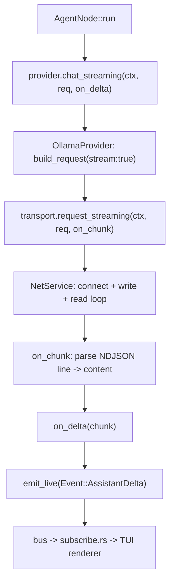

# pi-improved — spec-15: phase4-streaming

- **Project**: `/projects/pi-improved`
- **Priority**: R4 (blind waiting) from the opus Phase-4 review — the TUI shows `you> ... [seq 0x1a]` for tens of seconds with no text while a local model thinks. The whole delta pipeline exists; only the producer is missing.
- **Status**: SPECIFIED — not yet dispatched · *(lifecycle: SPECIFIED → IN PROGRESS
  on dispatch → IMPLEMENTED — awaiting review → DONE after the orchestrator
  commits and updates HANDOFF.md)*
- **Source**: Phase 4.1c - streaming assistant deltas (2026-09-07)
- **Depends-On**: spec 13 (4.1a) — landed `num_ctx`/`temperature`/`num_predict` forwarding in `ollama.rs`; spec 14 (4.1b) — landed compaction + per-tool timeouts. This spec builds on the `ChatRequest`/`ChatResponse` shape from 4.1a.

---

## Verified Premises

- `crates/pii-core/src/net.rs:12-22` — `HttpTransport` has exactly ONE method: `fn request(&self, ctx, req) -> Result<HttpResponse, PiiError>`. It reads the body to EOF (`read_to_deadline` in `pii-net/src/service.rs:293`). There is NO streaming/incremental-read method.
- `crates/pii-net/src/service.rs:272-290` — `NetService::request` connects once, authorizes, writes the request, then `read_to_deadline` reads the whole body. The `Conn` type exposes `read(&mut self, buf)` (service.rs:125) that reads incrementally — the primitive for streaming already exists on `Conn`.
- `crates/pii-model/src/lib.rs:115-123` — `ModelProvider` has exactly ONE method: `fn chat(&self, ctx, req) -> Result<ChatResponse, PiiError>`. No streaming variant.
- `crates/pii-model/src/ollama.rs:80-101` — `build_request` sends `"stream": false`; `chat` (ollama.rs:146) parses the whole JSON body into `OllamaChat`. Ollama's `/api/chat` with `stream: true` returns NDJSON lines, each `{"message":{"content":"<chunk>"},"done":false}` and a final `{"done":true,...}`.
- `crates/pii-proto/src/event.rs:76-83` — `Event::AssistantDelta { run_id, session_id, text }` exists. `subscribe.rs:159,179,209` already routes/filters/names it. The TUI renderer already renders it (per the opus review: "the whole delta pipeline exists (proto variant, bus routing, subscribe.rs filtering, TUI renderer); only the producer is missing").
- `crates/pii-server/src/agent.rs:240-244` — `emit_live` sends a `SeqEvent` to the bus. `run_tool_calls` already emits `ToolCall`/`ToolResult` live events.
- `crates/pii-server/src/agent.rs:110-117` — `AgentNode::run` reads `input.payload["prompt"]`; the run input carries `session` (runs.rs:67 sets `{"prompt": ..., "session": session_id}`). So `session_id` is available as `input.payload["session"]`.
- `crates/pii-server/src/agent.rs:19-31` — `AgentNode` has `run_id`/`node` from `ctx.trace()` (used in `run_tool_calls`), and `live: Option<Sender<SeqEvent>>`.

---

## Overview

The opus Phase-4 review's **R4**: *"Blind waiting, and nothing stops. No streaming: `granite4.2:3b` on CPU, four turns, tool calls — the TUI shows `you> ... [seq 0x1a]` for tens of seconds with no text. The whole delta pipeline exists (proto variant, bus routing, `subscribe.rs` filtering, TUI renderer); only the producer is missing."*

This spec adds the missing producer: **streaming assistant deltas from the Ollama provider to the bus**, so the TUI shows text as it is generated instead of a frozen seq indicator.

The change is deliberately narrow and additive:
1. Add a **streaming transport method** to `HttpTransport` (incremental chunk reads through the existing `Conn::read`).
2. Add a **streaming chat method** to `ModelProvider` that takes an `on_delta` callback.
3. Implement both in `NetService` and `OllamaProvider` respectively.
4. Wire `AgentNode::run` to call the streaming variant and emit `Event::AssistantDelta` per chunk.

**Streaming is opt-in per call** — the non-streaming `chat`/`request` paths stay byte-identical (the `scripted:` fixture and all existing tests keep working). The `stream: false` default in `build_request` is only flipped when the streaming method is used.

---

## Requirements

### Functional

- **R1 (streaming transport)**: `HttpTransport` gains `fn request_streaming(&self, ctx, req, on_chunk: &mut dyn FnMut(&[u8])) -> Result<HttpResponse, PiiError>`. `NetService` implements it by connecting once (same authorize/pin/dial as `request`), writing the request, then reading incrementally via `Conn::read`, calling `on_chunk` per read, and finally parsing the accumulated body into an `HttpResponse`. The default implementation (for fakes) falls back to `request` + a single `on_chunk` call.
- **R2 (streaming provider)**: `ModelProvider` gains `fn chat_streaming(&self, ctx, req, on_delta: &mut dyn FnMut(&str)) -> Result<ChatResponse, PiiError>`. `OllamaProvider` implements it by sending `stream: true`, reading NDJSON lines incrementally, calling `on_delta` with each `message.content` chunk, and returning the accumulated `ChatResponse` (text + tool_calls + token counts). The default implementation (for `ScriptedProvider` and fakes) calls `chat` and emits the full text as one delta.
- **R3 (agent emits deltas)**: `AgentNode::run` calls `chat_streaming` instead of `chat`, passing a closure that emits `Event::AssistantDelta { run_id, session_id, text: chunk }` via `emit_live` for each chunk. `session_id` comes from `input.payload["session"]` (fallback to empty string if absent). The accumulated `ChatResponse` is used exactly as today (tool_calls, budget charge, message append).
- **R4 (non-streaming unchanged)**: the `scripted:` provider and all existing tests that use `chat` keep working byte-identically. `stream: false` remains the default for the non-streaming `chat` path.

### Non-Functional

- **N1**: existing behaviour must not change for non-streaming callers — `chat`/`request` are untouched.
- **N2**: no new runtime dependencies. NDJSON parsing uses `serde_json` (already a dep).
- **N3**: the quality gate stays green; the test count may only go up.
- **N4**: `cargo xtask deps-check` and `cargo xtask net-check` still pass — no new dependency edges, no new socket-opening code (streaming reuses `Conn::read`).

---

## Architecture

**Key decision — streaming via a callback, not a channel.** The engine is synchronous (`GraphNode::run` runs on a blocking thread). A callback (`on_delta: &mut dyn FnMut(&str)`) lets the provider push chunks as they arrive without introducing async or a channel. The agent's closure captures `&self` (for `emit_live`) and the `run_id`/`session_id`/`node`. Rejected: a `mpsc` channel (adds a consumer thread and lifetime complexity for no benefit in a sync loop).

**Key decision — `request_streaming` on the transport, not a new socket path.** Streaming reuses the existing `Conn::read` primitive and the single-connect authorize/pin/dial chokepoint. This keeps `net-check` green (no new socket-opening code) and preserves the byte-budget accounting. Rejected: having `OllamaProvider` open its own socket (violates the single-connect invariant).

**Key decision — NDJSON parsed incrementally, not buffered.** Each `on_chunk` appends to a line buffer; a complete line is parsed as `OllamaChat` and its `message.content` forwarded to `on_delta`. The final `{"done":true}` line carries the token counts. This is the difference between "streaming" and "read-then-parse".

**What this spec is not**: session persistence (P4.2), memory v2 (P4.3), TLS (P4.4). Those are separate specs.

---

## TDD Contract

| id | test | given | expects |
|----|------|-------|---------|
| R1 | `request_streaming_emits_chunks` (pii-net unit, FakeHttpServer) | a server that sends a body in 3 chunks | `on_chunk` is called 3 times with the chunk bytes; the returned `HttpResponse.body` is the concatenation |
| R1 | `request_streaming_default_falls_back` (pii-core unit) | a fake `HttpTransport` that only implements `request` | `request_streaming` calls `request` once and `on_chunk` once with the full body |
| R2 | `ollama_streaming_emits_deltas` (pii-model unit, FakeHttpServer) | a server returning NDJSON: `{"message":{"content":"Hel"},"done":false}`, `{"message":{"content":"lo"},"done":false}`, `{"done":true,"prompt_eval_count":5,"eval_count":3}` | `on_delta` is called with "Hel" then "lo"; the returned `ChatResponse.text == "Hello"`, `tokens_in == 5`, `tokens_out == 3` |
| R2 | `ollama_streaming_sends_stream_true` (pii-model unit) | a `ChatRequest` | the request body sent to the server has `"stream": true` |
| R3 | `agent_emits_assistant_delta` (pii-server unit) | a `RecordingProvider`-style fake whose `chat_streaming` calls `on_delta("Hel")` then `on_delta("lo")`; a live bus sender | the bus receives two `Event::AssistantDelta` events with `text == "Hel"` and `"lo"`, correct `run_id`/`session_id` |
| R3 | `agent_streaming_uses_session_from_input` (pii-server unit) | run input with `session: "s1"` | the emitted `AssistantDelta.session_id == "s1"` |
| R4 | `scripted_provider_streams_full_text` (pii-model unit) | `ScriptedProvider` with a 1-turn fixture | `chat_streaming` calls `on_delta` once with the full text; `chat` still returns the same `ChatResponse` |

**R2 (`ollama_streaming_emits_deltas`) is the acceptance test.** The requirement a plausible implementation gets wrong: it reads the whole body then parses (no incremental `on_delta` calls), or it forgets to flip `stream: true`. The test asserts both the incremental deltas AND the accumulated `ChatResponse`.

---

## Exit Criteria

- [ ] `cargo build --workspace --all-targets` — compiles (R1-R4)
- [ ] `cargo test -p pii-net request_streaming` — streaming transport tests pass (R1)
- [ ] `cargo test -p pii-model ollama_streaming` — provider streaming tests pass (R2)
- [ ] `cargo test -p pii-server agent_emits_assistant_delta` — agent delta emission passes (R3)
- [ ] `cargo test -p pii-model scripted_provider_streams` — non-streaming unchanged (R4)
- [ ] `cargo test --workspace` — 0 failures (N3)
- [ ] `cargo clippy --workspace --all-targets -- -D warnings` — 0 errors (N3)
- [ ] `cargo fmt --all --check` — clean (N3)
- [ ] `cargo xtask lint-files` — 0 hard errors (N3)
- [ ] `cargo xtask deps-check` — pass (N4)
- [ ] `cargo xtask net-check` — pass (N4)

**Prose criteria**:

1. Test counts pasted raw, one line per binary, **unsummed**.
2. The `on_delta` callback must be invoked incrementally (per chunk), not once with the full text — a single call means the implementation buffered instead of streamed.

---

## Guardrails

- **G1 — do NOT edit this spec.** If it is wrong, STOP and report it.
- **G2 — do NOT commit.** Leave work in the working tree.
- **G3 — do NOT weaken, skip or delete an existing test.**
- **G4 — do NOT regenerate a pinned fixture.**
- **G5 — no hardcoded absolute paths.** Test artefacts under `_tmp/`.
- **G6 — report raw output, never summed totals.**
- **G7 — do NOT change the non-streaming `chat`/`request` paths.** They must stay byte-identical; streaming is additive and opt-in.
- **G8 — do NOT open a new socket path.** Streaming reuses `Conn::read`; `net-check` must stay green.

### Error handling expectations

- A malformed NDJSON line during streaming must return `PiiError::Invalid`, not silently skip (a dropped delta is a silent correctness bug).
- A transport error mid-stream (connection drop) must surface as `PiiError::Unavailable`, not hang.
- The final `{"done":true}` line must be parsed for token counts; if it is missing, the accumulated text is still returned (best-effort) but `tokens_in`/`tokens_out` default to 0.

---

## Files to Modify

| File | Change |
|------|--------|
| `crates/pii-core/src/net.rs` | `HttpTransport` gains `request_streaming` with a default fallback (R1) |
| `crates/pii-net/src/service.rs` | `NetService` implements `request_streaming` via `Conn::read` loop (R1) |
| `crates/pii-model/src/lib.rs` | `ModelProvider` gains `chat_streaming` with a default fallback (R2) |
| `crates/pii-model/src/ollama.rs` | `OllamaProvider` implements `chat_streaming` (NDJSON incremental parse, `stream: true`) (R2) |
| `crates/pii-server/src/agent.rs` | `AgentNode::run` calls `chat_streaming`, emits `Event::AssistantDelta` per chunk (R3) |

**Not modified**: `crates/pii-proto/` (the `AssistantDelta` event already exists), `crates/pii-tools/` (no tool change), `crates/pii-server/src/subscribe.rs` (already routes deltas).
