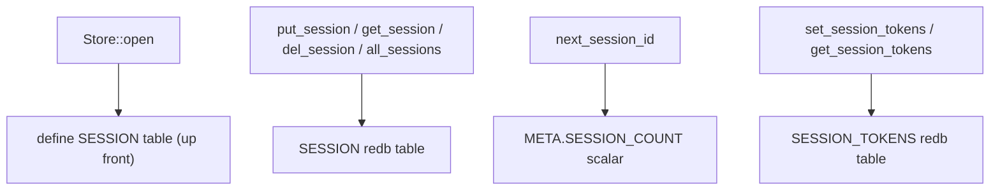

# pi-improved — spec-16: phase4-session-durability (part 1/2)

- **Project**: `/projects/pi-improved`
- **Priority**: R2 (daemon restart is amnesia) from the opus Phase-4 review — sessions vanish on restart; new sessions reuse `s1`,`s2`; `session.list` lies and `session.state` fakes token counts.
- **Status**: SPECIFIED — not yet dispatched · *(lifecycle: SPECIFIED → IN PROGRESS
  on dispatch → IMPLEMENTED — awaiting review → DONE after the orchestrator
  commits and updates HANDOFF.md)*
- **Source**: Phase 4.2 - session durability + run-lifecycle truth (2026-09-07)
- **Depends-On**: spec 15 (4.1c). None of the session code touched here overlaps with streaming.

---

## Verified Premises

- `crates/pii-server/src/lib.rs:101` — `Engine.sessions` is `parking_lot::Mutex<BTreeMap<String, Session>>` — RAM-only, lost on restart.
- `crates/pii-server/src/lib.rs:242` — `create_session` assigns `id = format!("s{}", self.sessions.lock().len() + 1)` — collides by construction if a session is ever removed; no store-counter.
- `crates/pii-server/src/lib.rs:444-445` — `session_state` hardcodes `tokens_in: 0, tokens_out: 0`.
- `crates/pii-store/src/tables.rs:16-38` — redb tables exist: `META`, `GRAPH_BODY`, `RUN`, `RUN_JOURNAL`, `RUN_SNAPSHOT`, `RUN_BY_STATUS`, `RESUME_INDEX`. There is NO `SESSION` table.
- `crates/pii-store/src/lib.rs:47-100` — `Store::open` defines all tables up front in one write txn (the table-creation pattern to extend for a `SESSION` table).
- `crates/pii-store/src/lib.rs:132-159` — `next_run_id` reads `META` (a monotonically-counted run id) — the pattern to mirror for a session id counter.
- `crates/pii-proto/src/session.rs:80-95` — `SessionStateResult` already has `tokens_in: u64` and `tokens_out: u64` fields (server-computed); the wire shape needs no change.
- `crates/pii-server/src/lib.rs:430-449` — `session_state` builds `SessionStateResult` from the RAM map; only the token fields are fake.
- `crates/pii-proto/src/method.rs:35,124,167` — `Method::SessionList` is declared and string-mapped to `"session.list"` but has NO dispatch arm in `dispatch.rs` (falls through to `MethodNotFound`).

---

## Overview

The opus Phase-4 review's **R2**: *"Daemon restart is amnesia. Sessions vanish; new sessions reuse ids `s1`,`s2`…; runs left `Running` by a crash are never reconciled. Timers survive (persisted `TimerWheel`) — which makes the sessions gap look even more like an oversight."*

Part 1 (this spec) builds the **durable store foundation** without changing the wire protocol or the daemon's observable behaviour yet:
1. A `SESSION` redb table to persist sessions (id-keyed, serde_json value).
2. A monotonic session-id counter in `META` (so ids never collide after a removal/restart).
3. Durable per-session token accumulation (a place to store `tokens_in`/`tokens_out` so the server-computed fields in `SessionStateResult` can be real).

Part 2 (spec 16 part2) wires it: implements `session.list`, makes `session.state` read real tokens, adds boot reconciliation, and adds retention/prune.

---

## Requirements

### Functional

- **R1 (SESSION table)**: `pii-store` gains a `SESSION` table (`&str` key = session id, value = serde_json bytes) plus `put_session(&self, id, bytes)` / `get_session(&self, id) -> Option<Vec<u8>>` / `del_session(&self, id)` / `all_sessions(&self) -> Vec<(String, Vec<u8>)>`, each in its own redb write/read txn (mirroring `put_graph`/`get_graph` at lib.rs:161-205).
- **R2 (session id counter)**: `pii-store` gains `next_session_id(&self) -> Result<u64, PiiError>` reading/writing a `SESSION_COUNT` scalar in `META` (mirror `next_run_id` at lib.rs:132-159). IDs therefore never collide.
- **R3 (session token store)**: `pii-store` gains `set_session_tokens(&self, id, in: u64, out: u64) -> Result<(), PiiError>` and `get_session_tokens(&self, id) -> Option<(u64, u64)>`, backed by the same `SESSION` table or a dedicated `SESSION_TOKENS` table (implementer's choice; keep it simple). These are the durable source for the `SessionStateResult.tokens_*` fields.

### Non-Functional

- **N1**: `pii-store` remains the ONLY redb-writing crate (`cargo xtask deps-check` invariant: redb confined to pii-store).
- **N2**: no new runtime dependencies.
- **N3**: the quality gate stays green; the test count may only go up.
- **N4**: `cargo xtask deps-check` and `cargo xtask net-check` still pass.

---

## Architecture

**Key decision — separate `SESSION_TOKENS` table over cramming tokens into the session value.** The session value (cwd, tools, graph, status, messages, run_id) can change independently of token counts, and `session.state` is called far more often than other mutations. A separate token table lets the server read/write tokens without deserialising the whole session. Rejected: merging tokens into the `SESSION` value (couples unrelated write frequencies).

**Key decision — the store API is additive; the engine still owns the RAM map.** Part 1 only adds the durable substrate. Nothing calls `put_session` yet (that's part 2's wiring). This keeps part 1 a pure store-layer addition that can land green standalone.

**What this spec is not**: `session.list`, real `session.state` tokens, boot reconciliation, retention (all in part 2), the CLI `pii tui --session` reattach (a later item).

---

## TDD Contract

| id | test | given | expects |
|----|------|-------|---------|
| R1 | `session_put_get_roundtrip` (pii-store unit) | a temp redb | `put_session("s1", b"xyz")` then `get_session("s1")` returns the same bytes |
| R1 | `session_del_removes` (pii-store unit) | put then del | `get_session` returns `None`; `all_sessions` no longer lists it |
| R1 | `session_all_lists` (pii-store unit) | put 3 sessions | `all_sessions` returns all 3 in iteration order |
| R2 | `session_id_counter_monotonic` (pii-store unit) | 5 × `next_session_id` | returns `1,2,3,4,5`; a reopened store continues from a value above the max persisted |
| R3 | `session_token_roundtrip` (pii-store unit) | set then get | `get_session_tokens` returns the same `(in, out)` |
| R3 | `session_token_default_zero` (pii-store unit) | get on a never-set id | returns `(0, 0)` or `None` (documented choice) |

**R2 (`session_id_counter_monotonic`) is the acceptance test.** The requirement a plausible implementation gets wrong: it computes the next id from the current session count (`len + 1`, the existing bug) instead of a monotonic counter, so it collides again after a removal. The test's "reopened store continues above the max" assertion catches both the collision and the restart-amnesia cases.

---

## Exit Criteria

- [ ] `cargo build --workspace --all-targets` — compiles (R1-R3)
- [ ] `cargo test -p pii-store session_` — session store tests pass (R1-R3)
- [ ] `cargo test -p pii-store` — all store tests pass (N3)
- [ ] `cargo test --workspace` — 0 failures (N3)
- [ ] `cargo clippy --workspace --all-targets -- -D warnings` — 0 errors (N3)
- [ ] `cargo fmt --all --check` — clean (N3)
- [ ] `cargo xtask lint-files` — 0 hard errors (N3)
- [ ] `cargo xtask deps-check` — pass (N4)
- [ ] `cargo xtask net-check` — pass (N4)

**Prose criteria**:

1. Test counts pasted raw, one line per binary, **unsummed**.
2. The store API must be additive — no caller of the RAM `Engine.sessions` map changes in this part.

---

## Guardrails

- **G1 — do NOT edit this spec.** If it is wrong, STOP and report it.
- **G2 — do NOT commit.** Leave work in the working tree.
- **G3 — do NOT weaken, skip or delete an existing test.**
- **G4 — do NOT regenerate a pinned fixture.**
- **G5 — no hardcoded absolute paths.** Test artefacts under `_tmp/`.
- **G6 — report raw output, never summed totals.**
- **G7 — do NOT touch `Engine.sessions` (the RAM map), `create_session`, `session_state`, or `dispatch.rs`.** Those are part 2. This part is store-only. A violation is detectable: part 1 must compile with only `pii-store` edited.
- **G8 — do NOT add redb outside `pii-store`.** `deps-check` enforces this.

### Error handling expectations

- A redb failure in any new store method must return `PiiError::Internal`, never panic or swallow.
- `next_session_id` must be atomic (read-modify-write in ONE txn) so two callers cannot mint the same id.

---

## Files to Modify

| File | Change |
|------|--------|
| `crates/pii-store/src/tables.rs` | add `SESSION` and `SESSION_TOKENS` table definitions (R1, R3) |
| `crates/pii-store/src/lib.rs` | add `put_session`/`get_session`/`del_session`/`all_sessions`/`next_session_id`/`set_session_tokens`/`get_session_tokens` (R1-R3); register the tables in `Store::open` |

**Not modified**: `crates/pii-server/` (all wiring is part 2), `crates/pii-proto/` (wire shape already has the fields), `crates/pii-cli/`.
