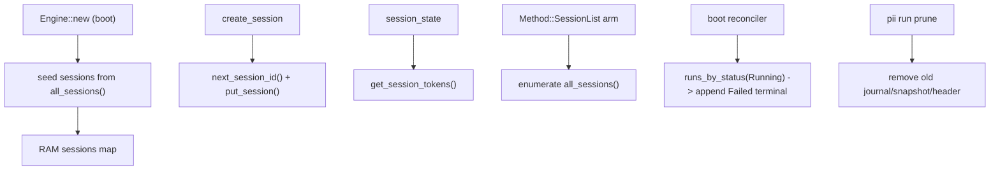

# pi-improved — spec-16: phase4-session-durability (part 2/2)

- **Project**: `/projects/pi-improved`
- **Priority**: R2 (daemon restart is amnesia) — sessions vanish, `session.list` lies, `session.state` fakes tokens, crashed runs stay `Running` forever.
- **Status**: SPECIFIED — not yet dispatched · *(lifecycle: SPECIFIED → IN PROGRESS
  on dispatch → IMPLEMENTED — awaiting review → DONE after the orchestrator
  commits and updates HANDOFF.md)*
- **Source**: Phase 4.2 - session durability + run-lifecycle truth (2026-09-07)
- **Depends-On**: spec 16 part 1 — the `SESSION` table, `next_session_id`, and token store it adds.

---

## Verified Premises

- `crates/pii-server/src/lib.rs:101` — `Engine.sessions` is a RAM `BTreeMap`; sessions are not persisted.
- `crates/pii-server/src/lib.rs:242` — `create_session` uses `format!("s{}", len + 1)` — must switch to the store's `next_session_id` (part 1 R2) and persist via `put_session` (part 1 R1).
- `crates/pii-server/src/lib.rs:444-445` — `session_state` hardcodes `tokens_in: 0, tokens_out: 0`.
- `crates/pii-server/src/dispatch.rs:83` — `Method::SessionState` dispatch arm exists; `Method::SessionList` (method.rs:35) has NO arm (falls through to `MethodNotFound`).
- `crates/pii-server/src/lib.rs:430-449` — `session_state` builds `SessionStateResult { tokens_in: 0, tokens_out: 0, ... }` — the fields to populate from the store.
- `crates/pii-server/src/runs.rs:46,125` — `run.start`/resume spawn via `spawn_blocking`; a crash leaves the run's `RUN_BY_STATUS` index pointing at `Running` forever (nothing reads `runs_by_status(Running)` at boot — confirmed `runs_by_status` has exactly one caller, dispatch.rs:202, which is the `run.list` path, not boot reconciliation).
- `crates/pii-store/src/lib.rs:397-…` — `runs_by_status(status)` lists run ids by lifecycle status (the boot-reconciliation sweep reads `Running` from here).
- `crates/pii-server/src/daemon/scheduler.rs:116` — `Engine::new` builds the daemon engine; boot reconciliation belongs right after `Engine::new` in the daemon startup path.

---

## Overview

Part 2 wires the part-1 durable store into the live engine, so the daemon stops being amnesiac and stops lying:

1. **Persist sessions.** `create_session` mints ids from the store counter and writes the session to the `SESSION` table. The RAM map stays the hot path; on daemon boot, the RAM map is seeded from `all_sessions`.
2. **Real `session.state`.** Populate `tokens_in`/`tokens_out` from the store's token data.
3. **Implement `session.list`.** The dispatch arm that returns every session (id, status, run_id), ordered by id.
4. **Boot reconciliation.** At daemon start, sweep `runs_by_status(Running)` and append a `NodeInterrupted`/`Failed`-style terminal so zombie `Running` runs are surfaced, not silently re-used.
5. **Retention/prune.** `pii run prune --before <date>` (or a `--ttl` flag) to bound the unbounded journal.

---

## Requirements

### Functional

- **R1 (session persistence)**: `create_session` mints ids from `store.next_session_id()` and writes a serialized `Session` via `store.put_session`. On `Engine::new` (daemon startup), seed the RAM map from `store.all_sessions()`, so a restart sees prior sessions. Session mutations (status/run_id/messages) are persisted when they matter — on `create`,`prompt`, and terminal.
- **R2 (real token counts)**: `session_state` reads `store.get_session_tokens(id)` and returns the real `(in, out)` instead of the hardcoded `(0,0)`.
- **R3 (session.list)**: `Method::SessionList` gets a dispatch arm returning an array of `{session_id, cwd, status, run_id}` for every session in the map (or all persisted sessions), ordered by id. Add a `SessionListResult` (or reuse a Vec) in `pii-proto::session`.
- **R4 (boot reconciliation)**: at daemon boot, sweep `store.runs_by_status(Running)`; for each, append a terminal `Failed { error: "interrupted by daemon restart" }` to its journal and repoint `RUN_BY_STATUS` to `Failed`. (The journal's existing `NodeInterrupted` mechanism from spec 11 is the audit marker; the run-level terminal is the lifecycle fix.)
- **R5 (retention/prune)**: `pii run prune [--before <date>] [--ttl <dur>]` removes run journal/snapshot/header entries older than the bound (or all if no bound), and repoints `RUN_BY_STATUS`. CLI + protocol method.

### Non-Functional

- **N1**: `pii-store` remains the only redb writer (`deps-check`).
- **N2**: no new runtime dependencies.
- **N3**: the quality gate stays green; the test count must go up.
- **N4**: **session id stability** — a session id minted in a prior daemon life must not be re-minted or collide (the `len+1` bug is gone). No external pidag/scripts may depend on `s1`,`s2` ordering (verify none do before shipping; the plan's open-question 7).

---

## Architecture

**Key decision — RAM map stays the hot path, store is the source of truth for boot.** The map gives sub-ms session lookups; the store gives durability. The store is written on lifecycle transitions (create/prompt/terminal), not every message append (that would be the rss-gate slope again). Rejected: making the store the live read path (too many redb reads per turn).

**Key decision — boot reconciliation marks crashed runs `Failed`, not `Resumed`.** A crash-interrupted run cannot be safely resumed (no reliable state). Marking it `Failed { error: "interrupted by daemon restart" }` surfaces the truth; the operator re-runs if they want. The journal's `NodeInterrupted` (spec 11) already documents which node was mid-flight.

**Key decision — prune targets the journal, not the run.** The unbounded resource is `RUN_JOURNAL` (per the rss-gate analysis). Prune removes old journal/snapshot/header rows; run state is reconstructible or disposable.

**What this spec is not**: TUI reattach (`pii tui --session <id>` — a later item), cross-process session leases (the plan says defer), memory v2 (P4.3).

---

## TDD Contract

| id | test | given | expects |
|----|------|-------|---------|
| R1 | `session_persists_across_restart` (pii-server integration) | create a session, drop the engine, re-open the store | the session id is not re-minted; the session is re-seeded into the new RAM map |
| R1 | `session_id_does_not_collide_after_removal` | create s1..s5, remove s3, create again | the new id ≠ any existing id (monotonic counter) |
| R2 | `session_state_returns_real_tokens` | `set_session_tokens(s1, 10, 20)` then `session_state("s1")` | `tokens_in == 10`, `tokens_out == 20` (not 0) |
| R3 | `session_list_returns_all` | create 2 sessions | `session.list` returns both, ordered by id |
| R3 | `session_list_empty` | no sessions | returns an empty array (not an error) |
| R4 | `boot_reconciles_running_runs` | a run left `Running` in the store, then `Engine::new` boots | the run is marked `Failed` with "interrupted by daemon restart"; `runs_by_status(Running)` no longer lists it |
| R5 | `prune_removes_old_runs` | runs older than the bound | their journal/header/snapshot rows are gone; `runs_by_status` no longer lists them |

**R4 (`boot_reconciles_running_runs`) is the acceptance test.** The requirement a plausible implementation gets wrong: it "forgets" the zombie by silently removing the status index (hiding the crash) instead of surfacing it with a `Failed` terminal. The test asserts the terminal is appended AND the zombie leaves `Running`.

---

## Exit Criteria

- [ ] `cargo build --workspace --all-targets` — compiles (R1-R5)
- [ ] `cargo test -p pii-server session_` — session persistence/list/token tests pass (R1-R3)
- [ ] `cargo test -p pii-server boot_reconcile` — boot reconciliation passes (R4)
- [ ] `cargo test -p pii-server prune_` — prune test passes (R5)
- [ ] `cargo test -p pii-store session_` — part-1 store tests still pass (N3)
- [ ] `cargo test --workspace` — 0 failures (N3)
- [ ] `cargo clippy --workspace --all-targets -- -D warnings` — 0 errors (N3)
- [ ] `cargo fmt --all --check` — clean (N3)
- [ ] `cargo xtask lint-files` — 0 hard errors (N3)
- [ ] `cargo xtask deps-check` — pass (N1)
- [ ] `cargo xtask net-check` — pass (N1)

**Prose criteria**:

1. Test counts pasted raw, one line per binary, **unsummed**.
2. Confirm no external script/pidag/note references `s1`/`s2` session-ids that would break under the counter change (plan open-question 7).
3. The boot reconciler must append a `Failed` terminal (visible in `run.list`/`trace`), not silently drop the Zombie.

---

## Guardrails

- **G1 — do NOT edit this spec.** If it is wrong, STOP and report it.
- **G2 — do NOT commit.** Leave work in the working tree.
- **G3 — do NOT weaken, skip or delete an existing test.**
- **G4 — do NOT regenerate a pinned fixture.**
- **G5 — no hardcoded absolute paths.** Test artefacts under `_tmp/`.
- **G6 — report raw output, never summed totals.**
- **G7 — do NOT touch `pii-store`'s redb internals beyond calling its new API.** The store table definitions are owned by part 1; this part only calls the methods.
- **G8 — boot reconciliation must NOT auto-resume.** A crashed run is marked `Failed`, never silently re-run. (The plan's `--resume` policy is a separate, explicit flag.)

### Error handling expectations

- Boot reconciliation failures (redb error mid-sweep) must not crash the daemon; log/return and continue, but the failed run must NOT be left silently `Running`.
- `session.list` with zero sessions returns `[]`, not an error.
- Prune must leave non-matching (recent) runs untouched — no over-pruning.

---

## Files to Modify

| File | Change |
|------|--------|
| `crates/pii-server/src/lib.rs` | `create_session` (counter + persist), `session_state` (real tokens), boot seeding, boot reconciler (R1-R4) |
| `crates/pii-server/src/dispatch.rs` | `Method::SessionList` arm (R3) |
| `crates/pii-proto/src/session.rs` | `SessionListResult` (R3) |
| `crates/pii-server/src/daemon/scheduler.rs` or `cmd_daemon.rs` | boot reconciler call site after `Engine::new` (R4) |
| `crates/pii-cli/src/cmd_run.rs` | `pii run prune` (R5) |
| `crates/pii-proto/src/method.rs` | `Method::RunPrune` (R5), if not already present |

**Not modified**: `crates/pii-store/src/tables.rs` (part 1), `crates/pii-proto/src/event.rs` (interruption events exist).
