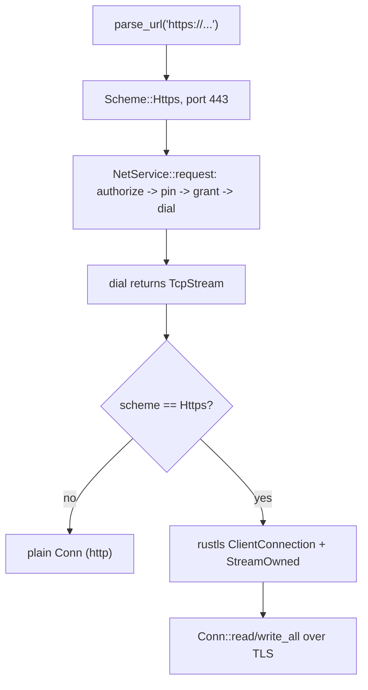

# pi-improved — spec-17: phase4-tls

- **Project**: `/projects/pi-improved`
- **Priority**: P4.4 — outbound TLS unblocks the `deepseek:` provider, `DiscordChannel`, and any GitHub/GitLab tool. One missing feature blocks three shipped-looking ones (opus review).
- **Status**: SPECIFIED — not yet dispatched · *(lifecycle: SPECIFIED → IN PROGRESS
  on dispatch → IMPLEMENTED — awaiting review → DONE after the orchestrator
  commits and updates HANDOFF.md)*
- **Source**: Phase 4.4 - outbound TLS in pii-net (2026-09-07)
- **Depends-On**: spec 13 (4.1a) — env scrubbing landed (the hard prerequisite the opus plan named for TLS).

---

## Verified Premises

- `crates/pii-net/src/http_codec.rs:10-13` — `Scheme` has ONLY `Http`; `parse_url` (http_codec.rs:24-53) refuses `https` with "https requires the tls feature (Phase 3b)".
- `crates/pii-net/src/dial.rs:19-39` — `dial` returns a raw `std::net::TcpStream`; it is the ONE sanctioned `TcpStream::connect` site (net-check allowlist).
- `crates/pii-net/src/service.rs:272-290` — `NetService::request` connects, writes, reads via `Conn` (which wraps the `TcpStream`). `request_streaming` (service.rs:296-353) does the same incrementally.
- `crates/pii-net/src/service.rs:32-37` — `Conn { stream: TcpStream, ... }` — the stream is a plain TCP stream; TLS would wrap it.
- `crates/pii-net/Cargo.toml:10-16` — deps are `pii-abi`, `pii-core`, `serde`, `serde_json`, `thiserror`, `parking_lot`. NO rustls yet.
- `xtask/src/deps.rs:14-16` — `rustls` is in `FORBIDDEN_TRANSITIVE` for `pii-abi` only (not pii-net). Adding rustls to pii-net does NOT violate deps-check as long as pii-abi stays pure.
- `xtask/src/net_check.rs:27-33` — `ALLOWLIST` includes `crates/pii-net/src/dial.rs`; TLS wrapping happens inside pii-net so net-check stays green (no new socket-opening code outside pii-net).
- `crates/pii-net/src/authorize.rs` — the authorize→pin→grant→dial chokepoint is unchanged by TLS; TLS wraps the stream AFTER dial, so the egress policy still gates the connection.

---

## Overview

The opus Phase-4 review's **P4.4**: *"Outbound only: add `Scheme::Https` to `http_codec.rs`; wrap the `TcpStream` `dial.rs` returns in a rustls client connection. The authorize → pin → grant → dial chokepoint is unchanged; `net-check` keeps passing."*

This spec adds **outbound TLS** to `pii-net` so `https://` URLs work. It is deliberately narrow:
- **Outbound only** — the daemon's own listener stays plaintext-loopback (UDS + peercred is the right local security model; no localhost PKI).
- **rustls + webpki-roots**, server-cert verification ON, SNI from the parsed host, no client certs, no custom verifier.
- The authorize→pin→grant→dial chokepoint is unchanged — TLS wraps the stream AFTER dial, so egress policy still gates the connection.

This unblocks the `deepseek:` provider (HTTPS-only), `DiscordChannel` (default base `https://api.discord.com`), and any GitHub/GitLab tool.

---

## Requirements

### Functional

- **R1 (Scheme::Https)**: `Scheme` gains `Https`. `parse_url` accepts `https://` (default port 443) and returns `Scheme::Https`. The existing `http://` path is unchanged.
- **R2 (TLS wrap)**: `dial` (or a new `dial_tls` helper in pii-net) wraps the dialed `TcpStream` in a rustls client connection when the scheme is `Https`. Server-cert verification ON, SNI from the parsed host, webpki-roots as the trust store. No client certs, no custom verifier.
- **R3 (Conn carries TLS)**: `Conn`'s stream field becomes an enum or trait object that can be either a plain `TcpStream` (http) or a rustls `StreamOwned` (https), so `Conn::read`/`write_all` work for both. The byte-budget accounting and deadline logic are unchanged.
- **R4 (request/request_streaming dispatch)**: `NetService::request` and `request_streaming` dispatch on the scheme — `Http` uses the existing path, `Https` wraps in TLS before write/read. The authorize→pin→grant→dial chokepoint is unchanged.
- **R5 (deps-check invariant)**: add a deps-check invariant that `rustls` may appear only under `pii-net` (mirroring the redb-confined-to-pii-store rule), so TLS can't leak into other crates.

### Non-Functional

- **N1**: `net-check` stays green — no new socket-opening code outside pii-net; TLS wraps the stream inside pii-net.
- **N2**: `deps-check` stays green — rustls confined to pii-net; pii-abi stays pure.
- **N3**: the quality gate stays green; the test count may only go up.
- **N4**: no TLS on the daemon's own listener — the TCP listener stays plaintext-loopback.

---

## Architecture

**Key decision — TLS wraps the stream AFTER dial, inside pii-net.** The authorize→pin→grant→dial chokepoint is the security boundary; TLS is transport encryption on top of it. This keeps `net-check` green (no new socket code) and preserves the egress policy. Rejected: TLS before dial (would bypass the grant check) or TLS in a separate crate (would need a new socket path).

**Key decision — `Conn.stream` becomes an enum, not a trait object.** `enum Stream { Plain(TcpStream), Tls(StreamOwned<ClientConnection, TcpStream>) }` with `read`/`write_all` methods. A trait object adds a vtable and lifetime complexity for two variants. The enum keeps the byte-budget and deadline logic in `Conn` unchanged.

**Key decision — rustls + webpki-roots, `ring` provider.** The opus plan recommends `ring` over `aws-lc-rs` for build simplicity under `opt-level="z"` + fat LTO + `panic=abort`. Server-cert verification ON, SNI from the parsed host, no client certs, no custom verifier.

**What this spec is not**: TLS on the daemon's listener (N4), client certs, custom verifiers, multi-user.

---

## TDD Contract

| id | test | given | expects |
|----|------|-------|---------|
| R1 | `parse_url_accepts_https` (pii-net unit) | `parse_url("https://api.example.com/x")` | returns `Scheme::Https`, host `api.example.com`, port 443 |
| R1 | `parse_url_https_default_port` | `parse_url("https://h")` | port 443 (not 80) |
| R2 | `dial_tls_wraps_stream` (pii-net unit) | a fake TLS server | `dial_tls` returns a `StreamOwned` whose `read`/`write` work over the TLS connection |
| R3 | `conn_read_write_both_schemes` (pii-net unit) | a `Conn` with `Stream::Plain` and one with `Stream::Tls` | both `read`/`write_all` correctly; byte-budget accounting identical |
| R4 | `request_https_dispatch` (pii-net integration, FakeHttpServer) | a fake HTTPS server | `NetService::request` with an `https://` URL succeeds and returns the body |
| R5 | `deps_check_rejects_rustls_outside_pii_net` (xtask unit) | a fake crate depending on rustls | deps-check reports a violation |

**R4 (`request_https_dispatch`) is the acceptance test.** The requirement a plausible implementation gets wrong: it adds `Scheme::Https` to `parse_url` but forgets to actually wrap the stream in `request`/`request_streaming`, so `https://` URLs parse but still fail on the wire. The test asserts a real HTTPS request round-trips.

---

## Exit Criteria

- [ ] `cargo build --workspace --all-targets` — compiles (R1-R5)
- [ ] `cargo test -p pii-net parse_url_https` — https URL parsing (R1)
- [ ] `cargo test -p pii-net request_https` — https request round-trip (R4)
- [ ] `cargo test -p pii-net conn_` — Conn both-scheme read/write (R3)
- [ ] `cargo test -p xtask deps_check_rejects_rustls` — rustls confinement (R5)
- [ ] `cargo test --workspace` — 0 failures (N3)
- [ ] `cargo clippy --workspace --all-targets -- -D warnings` — 0 errors (N3)
- [ ] `cargo fmt --all --check` — clean (N3)
- [ ] `cargo xtask lint-files` — 0 hard errors (N3)
- [ ] `cargo xtask deps-check` — pass (N2)
- [ ] `cargo xtask net-check` — pass (N1)

**Prose criteria**:

1. Test counts pasted raw, one line per binary, **unsummed**.
2. The `https://` URL must actually round-trip a request (R4), not just parse — a parse-only implementation is a FAIL.
3. `net-check` and `deps-check` must both pass — TLS must not leak outside pii-net.

---

## Guardrails

- **G1 — do NOT edit this spec.** If it is wrong, STOP and report it.
- **G2 — do NOT commit.** Leave work in the working tree.
- **G3 — do NOT weaken, skip or delete an existing test.**
- **G4 — do NOT regenerate a pinned fixture.**
- **G5 — no hardcoded absolute paths.** Test artefacts under `_tmp/`.
- **G6 — report raw output, never summed totals.**
- **G7 — do NOT add TLS to the daemon's listener.** The TCP listener stays plaintext-loopback (N4).
- **G8 — do NOT add client certs or a custom verifier.** Server-cert verification ON, webpki-roots, SNI from host.
- **G9 — do NOT open a new socket path.** TLS wraps the stream `dial` returns, inside pii-net; `net-check` must stay green.

### Error handling expectations

- A TLS handshake failure must return `PiiError::Unavailable` (or `Invalid` for a cert error), never panic.
- A `https://` URL with an unreachable host must fail the same way an `http://` one does (Unavailable).
- The byte-budget and deadline logic must apply identically to TLS and plain streams.

---

## Files to Modify

| File | Change |
|------|--------|
| `crates/pii-net/Cargo.toml` | add `rustls`, `webpki-roots`, `ring` (R2) |
| `crates/pii-net/src/http_codec.rs` | `Scheme::Https`, `parse_url` accepts https (R1) |
| `crates/pii-net/src/dial.rs` | `dial_tls` helper wrapping the stream (R2) |
| `crates/pii-net/src/service.rs` | `Conn.stream` enum; `request`/`request_streaming` dispatch on scheme (R3, R4) |
| `xtask/src/deps.rs` | rustls-confined-to-pii-net invariant (R5) |

**Not modified**: `crates/pii-net/src/listen.rs` (no listener TLS), `crates/pii-net/src/authorize.rs` (chokepoint unchanged), `crates/pii-abi/` (stays pure).
